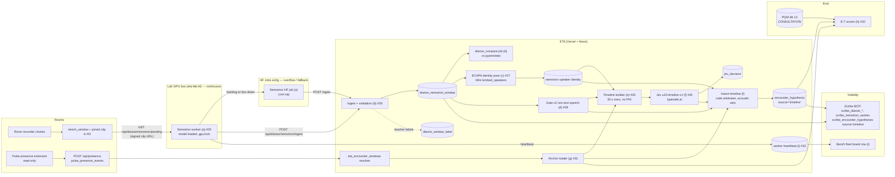

# PRD: Nemotron diarization in production + pre-STT encounter timeline

| | |
|---|---|
| Date | 9 Oct 2026 |
| Owner | Vinay (V) |
| Epic | [#23](https://github.com/vinaybhardwaj-commits/Even-Scribe-Architecture/issues/23) |
| Children | [#25](https://github.com/vinaybhardwaj-commits/Even-Scribe-Architecture/issues/25) (a) · [#26](https://github.com/vinaybhardwaj-commits/Even-Scribe-Architecture/issues/26) (b) · [#27](https://github.com/vinaybhardwaj-commits/Even-Scribe-Architecture/issues/27) (c) · [#28](https://github.com/vinaybhardwaj-commits/Even-Scribe-Architecture/issues/28) (d) · [#29](https://github.com/vinaybhardwaj-commits/Even-Scribe-Architecture/issues/29) (e) · [#30](https://github.com/vinaybhardwaj-commits/Even-Scribe-Architecture/issues/30) (f) · [#31](https://github.com/vinaybhardwaj-commits/Even-Scribe-Architecture/issues/31) (g) · [#32](https://github.com/vinaybhardwaj-commits/Even-Scribe-Architecture/issues/32) (h) · [#33](https://github.com/vinaybhardwaj-commits/Even-Scribe-Architecture/issues/33) (i) |
| Code base | ETA = `vinaybhardwaj-commits/Even-Transcription-Assistant`, `main` @ `5dfc222` (read 9 Oct). All paths below are ETA paths unless marked *Mini* (eta-lab on the Mini) |
| Status | Draft for builder |

**How to read this.** Facts read from code or lab files carry a path. Anything marked **[inferred]** is a proposal or an inference, not verified in code. Numbers marked **PROVISIONAL** are starting values that the bench or a ruling must confirm. This document contains no patient data. Every id in an example is fake.

---

## 1. Summary and decision

**Decision (V, 9 Oct 2026, 07:52 IST):** put `nvidia/Nemotron-3-Diarization` into ETA production.
- It runs **continuously on the lab GPU box** (`eta-lab-t4`, NVIDIA T4).
- **Hugging Face GPU jobs (a10g)** are overflow and fallback.

On top of the Nemotron turns we build a **pre-STT encounter timeline**:
1. Nemotron turns, the acoustic energy gate and ECAPA voiceprint identity are turned into a compact, text-only **speaker-turn timeline** with no names, no ids and no clock times.
2. The **Pulse presence Start** click is the strong anchor for a consult's start.
3. **Jev**, the LLM judgment layer, reads the timeline and mainly infers the **consult end**. The next Start counts as a soft end of the previous consult.
4. A pure code fusion step decides the final boundaries. It writes a new shadow hypothesis source, `timeline`, and nothing a clinician sees changes.

pyannote stays the production diarizer (`DIARIZE_ENGINE=pyannoteai`) until a Nemotron shadow compare passes (§9).

## 2. Problem and evidence

1. **The encounter-clock gate needs transcript text to call a probe "speech".**
   - `lib/encounter-clock/gate.ts:20-52` returns `speech` only when energy is active **and** the transcript reaches at least 0.15 unique characters per second. Active energy with no transcript is `unjudged`.
   - `lib/encounter-clock/shadow-io.ts:4-13` says: "Windows without a stored transcript contribute no text, and their probes come back unjudged."
   - So the acoustic clock depends on STT today, and STT lags or is missing for many windows.
2. **Recall is very low (E-7, scored against PQM consultation times):**

   | Day | Arms | Recall | Precision | Source (*Mini*) |
   |---|---|---|---|---|
   | 23 Sep, 3 rooms | acoustic / fused (STT+Jev) | **3/14** both | 4/13 / 3/7 | `eta-lab/orders/PLAN-v3.md` §C |
   | 24 Sep, 4 voiceprint-confirmed rooms | acoustic / fused / fused-e61 | **2/23** all | 2/55 / 2/19 | `eta-lab/studies/2026-09-24-e7-fullday/SCORE-24SEP.md` |
   | 24 Sep | arm d (lab segmenter, queue-informed, **not blind**) | 18/23 | 19/44 | same |

   - The stated cause on 24 Sep was that most probes had no stored transcript. On OPD 3, 406 of 579 probes had none and only 23 were judged.
3. **Pulse End is often missed.**
   - Doctors reliably click Start consult in Pulse, but often skip End consult.
   - The window resolver falls back to `url_clear` (left the patient page), then `next_open`, then `logout` / `idle_timeout`, then `cap_90m` (`lib/encounter-windows/compute.ts:13-16`).
   - `url_clear` is counted as an "explicit" close (`compute.ts:187`, `EXPLICIT_CLOSE`), alongside a real End click. That hides the missed End clicks.
   - **[inferred]** Missed End clicks appear as `url_clear` or `next_open` closes that land after the true end.
4. **Nemotron already works in the lab**, but nothing in production consumes it (§4.1).

## 3. Goals and non-goals

**Goals**
- G1. Diarize every closed room window with Nemotron in production. The worker runs continuously on the box and overflows to HF. Turns are stored in ETA, idempotently.
- G2. Attach doctor identity to Nemotron speakers through ECAPA, and fill the identity and `doctor_present` fields on encounter hypotheses.
- G3. Give the encounter-clock gate a **non-text speech half** (diarized speech seconds), so a probe can be judged without STT.
- G4. Build the speaker-turn timeline and a Jev prompt (`u10-timeline-v1`) that infers consult end, late start and kind from it.
- G5. Fuse Pulse anchors, acoustics, timeline and Jev into a shadow `timeline` hypothesis run, and score it with E-7 against PQM and the Pulse End-click subset.
- G6. Make worker health, lag and engine visible on the Bench fleet board and in Scribe MCP.

**Non-goals**
- Switching the production diarizer to Nemotron in this epic. That is a separate flag flip after the compare passes.
- Changing anything a clinician sees: notes, the kiosk, routing. Everything new is shadow.
- Changing Pulse code or the Pulse presence extension. They are read-only.
- Sending audio, transcript text or any patient identifier to Jev or the bus.
- Fine-tuning Nemotron. The lab SPLIT-2 track continues separately; the production worker uses the base model at a pinned revision.
- Replacing STT or the E-6 STT+Jev fused run. Both keep running and are scored as baselines.

## 4. Current state (with file references)

### 4.1 Nemotron: lab only
- **There is no Nemotron in ETA.** A grep for `nemotron|sortformer` over `main` and all remote branches finds nothing.
- `lib/diarize-engine.ts:29`: `DIARIZE_ENGINES = ["local","pyannoteai"]`. Any other value throws (`:47-58`).
- *Mini* `eta-lab/studies/2026-09-25-speaker-labels/l4_consume.py` is the working runner.
  - It calls `SortformerEncLabelModel.from_pretrained("nvidia/Nemotron-3-Diarization")` on CUDA.
  - Offline config: `spkcache 264 / fifo 40 / chunk 340 / right-context 40 / update 300`. NeMo Speech `cf724ac`, torch 2.14+cu126.
  - Input: whole 900 s windows, decoded to 16 kHz mono s16le.
  - Output per window: `{window_id, engine, audio_s, turns:[[start_s,end_s,spk]]}`. There are **no embeddings and no confidence**, and overlap shows only as intersecting turns.
- *Mini* `eta-lab/orders/DIAR-NEMOTRON-BAKEOFF.md`: about 100M parameters, up to 8 speakers, speaker activity only.
- *Mini* `eta-lab/handover/HANDOVER-diar-lab.md` and `RESULTS-337E.md`:
  - It ran on the box T4 under `flock /home/eta/gpu.lock` and on HF a10g. HF took about 12-16 s per audio-hour, with parity 1.0000 against the box.
  - The T4 cannot run short chunks, but whole windows work.
  - The 25-26 Sep run covered 4,167 windows across 12 rooms.
  - Against pyannote.ai on 317 reference windows, agreement was median 0.989 and 0.927 segment-weighted.
  - Speaker count is weak (ruling 94).
- *Mini* `eta-lab/kit/reb_runner/DESIGN.md:59` plans a REB `diar` layer with `nemotron-diar`, marked "not built yet".

### 4.2 Production diarization (pyannote)
- **Cron enqueue:** `lib/stt/diarize-job.ts:110-171`, flag `ROOM_DIARIZE_ENABLED`.
  - Eligible windows (`:123-143`): `bench_window.state IN ('closed','transcribed')`, grid-aligned, joined clip present, no row yet, attempts < 3, at most 4 per tick.
  - Diarization does not wait for STT text.
- **Job:** `lib/jobs/kinds/diarize-window.ts`.
  - Engine `local` uses Mini pyannote 3.1 + ECAPA at `https://diarize.llmvinayminihome.uk/diarize` (`lib/diarize.ts`).
  - Engine `pyannoteai` uses hosted pyannote.ai plus Mini `/embed_speakers` (`lib/diarize-embed.ts`).
- **Storage:**
  - `room_diarize_window.segments_json/speakers_json/timing_json`, written by `recordDiarizeWindow` (`lib/stt/diarize-window.ts:503-549`).
  - `room_turn_speaker`: identity per **STT turn** (`:398-423`).
  - Teacher labels: `diarize_window_label` (mig 0117).
- **Read API:** `lib/diarize-segments.ts:32-51` (`scribe_diarize_segments`).

### 4.3 Identity
- Mini ECAPA (`speechbrain/spkrec-ecapa-voxceleb`) cosine against `voice_print.centroid`, greedy in speech-time order, threshold 0.65 (`DIARIZE_BATCH_THRESHOLD`, `lib/stt/diarize-window.ts:38,57-72,246-251`). The rule for `attribution` is at `:177-183`.
- `voice_centroid` (mig 0113) exists, but "No routes call this yet" (`lib/voice-centroid.ts:22`).
- Per-turn EER is 14.9%. Ruling 182 says the stored voiceprints may fail on current audio.

### 4.4 Encounter clock (E-1 to E-7)
- **E-1 probes:** 180 s probes on a 60 s hop (`lib/encounter-clock/probe.ts`).
- **E-2 gate:** `gate.ts`, see §2.
- **E-4 smoother:** `smooth.ts` (`encounter-clock-smooth-v1`).
  - It opens after 2 speech probes and closes after 3 non_speech probes.
  - Unjudged time bridges at most 180 s.
  - `CLOSED_BY` = `non_speech, unjudged_gap, tape_off, dead_mic, end_of_input, content_boundary` (`:74-83`).
- **E-5 store:** mig 0114 (`encounter_hypothesis_run`, `encounter_hypothesis`).
  - The identity columns (`clinician_id`, `match_source`, `centroid_id`, `doctor_cosine`) exist but are never filled: `shadow.ts:119-121` writes `identity: null`, and `doctor_present` is never set.
- **E-6 fusion:** `shadow-v2.ts` and `fusion.ts`, flag `ENCOUNTER_FUSION_SHADOW`.
  - Per probe it asks Jev U1 phase, U6 kind and U2 start/end, using **translated transcript text**.
  - Mig 0118 adds `source ∈ {acoustic, fused}` and `content_boundary`.
- **E-7 scorer:** lives only in the lab (*Mini* `eta-lab/orders/E7-PQM-TRUTH.md`, `e7-rescore.sh`).
  - Truth: Metabase db 13 `queue_token_steps`, `station='CONSULTATION'`, `called_at` / `completed_at`.

### 4.5 Jev
- **Entry point:** `askJev(state, asks[], opts)` (`lib/jev/ask.ts:100-161`). It validates choices against the menu (`:90-93`), bands confidence (act 0.9, caution 0.5; `lib/jev/thresholds.ts`) and persists to `jev_decision` (mig 0116), with `prompt_version` on every row.
- **Client:** `lib/jev/client.ts` posts to `https://api.typesafe.ai/v1/systemone`.
  - Model: `ETA_JEV_MODEL`, default `jev-latest`.
  - Flags: `ETA_JEV_ENABLED` (unset → `JevDisabledError`), `ETA_JEV_MOCK`.
  - State guard: 100,000 characters. Timeout 15 s, 3 retries.
- **Registry:** `lib/jev/registry.ts`. Prompts are in `lib/jev/prompts/*` (`jev-arm-d-v1`, `u1-phase-w1`, `u2-boundary-v1`, `u6-kind-v2`, `jev-role-v1`, `jev-note-safety-v1`). **Every existing prompt takes English text.**
- **Subject types:** `window, turn, note_sentence, encounter, collapse, probe`.

### 4.6 Pulse presence
- **Extension:** `extensions/pulse-presence/` (MV3).
  - It watches `POST /api/emr/startConsult` and `/endConsult` and reads only `consult_uid`.
  - It emits `encounter_open` / `encounter_close`, `login`, `logout`, `idle`, `active` and `locked`, plus a heartbeat.
- **Ingest:** `POST /api/presence` (`app/api/presence/route.ts`) writes `pulse_presence_events` (mig 0122; source guard in 0125).
- **Resolver:** `lib/encounter-windows/compute.ts` writes `eta_encounter_windows` (mig 0123).
  - Row fields: `consult_key`, `room_id`, `t_open`, `t_close`, `close_reason ∈ {endConsult, url_clear, next_open, logout, idle_timeout, cap_90m, open}`, `quality`.
  - Mig 0124 adds the warehouse doctor.
- **Reference (2-4 Oct):** 114 consults, 21 `multi_doctor` (all OPD 4) (`docs/handoff/ETA-ENCOUNTER-WINDOWS-BUILD-04-OCT-2026.md:44`).
- **Consult cutter:** `tools/eta-consult-cutter` already makes Pulse-anchored, pre-STT cuts using pyannote + ECAPA:
  - start = t_open − 60 s
  - explicit close: end = t_close + 15 s
  - else: end = last doctor turn + 30 s, or min(next open, t_close + 10 min)

### 4.7 Migrations
The latest migration seen on `main` is **0139**. Every new migration takes the next free number at build time, and is additive and idempotent.

## 5. Architecture



**Data flow in words**
1. A window closes and its clip is joined to R2. This is unchanged.
2. The box worker pulls pending windows over an authenticated ETA route, diarizes each one and posts turns back. On backlog, or when the box is down, HF a10g jobs do the same under a daily dollar cap.
3. ETA stores the turns, runs an ECAPA identity pass over Nemotron speakers, and computes the diarized speech per probe for gate v2.
4. For each Pulse Start anchor, the timeline builder emits a 30 s row timeline. Jev answers four closed questions. Code fuses everything into a `timeline` hypothesis.
5. E-7 scores the `timeline` run against PQM and against the Pulse End-click subset, beside the existing arms.
6. The Bench board and MCP show worker health and lag, the engine, and the new hypotheses.

## 6. Detailed requirements per component

Each component maps one-to-one to a child issue. The issue holds the full acceptance checklist; this section states the contract.

### 6.1 (a) Nemotron worker: box continuous + HF overflow, [#25](https://github.com/vinaybhardwaj-commits/Even-Scribe-Architecture/issues/25)
- **Process.** A systemd service on `eta-lab-t4`. It keeps the model loaded and takes `flock /home/eta/gpu.lock` per window, so STT and backfill can preempt between windows.
- **Pinned runtime.** `nvidia/Nemotron-3-Diarization` at a pinned HF revision, the offline config from `l4_consume.py`, NeMo `cf724ac`, torch 2.14+cu126. `config_hash = sha256(canonical config JSON)`.
- **Work loop.**
  1. Call `GET /api/diarize/nemotron/pending` and claim with a lease.
  2. Fetch the clip by signed URL and check `clip_sha256`.
  3. Decode to 16 kHz mono and diarize.
  4. `POST /ingest`.
- **Credentials.** The worker holds only `NEMOTRON_WORKER_TOKEN`. It has no DB credentials, and no secret is passed on argv.
- **Idempotency.** The key is `(window_id, engine, model_rev, config_hash)`.
  - An identical re-post is a no-op. A different payload sha for the same key gets a 409 and is never overwritten.
  - The lease expires (PROVISIONAL 15 min), so a dead worker's claim can be stolen.
- **Retry.** At most 3 attempts per window, with the failure history kept. Decode failure is terminal for that window and records only an error code.
- **HF overflow** (PROVISIONAL thresholds `NEMO_HF_BACKLOG_THRESHOLD`):
  - Dispatch when the backlog is over 40 windows, the oldest waiting window is over 60 min old, or the box heartbeat has been stale for more than 10 min.
  - Use the existing `hf/hf_run.py` launcher pattern (*Mini*) and run the HF 402/credit probe first.
  - Audio staged on HF is deleted once the result is verified (lab rule r382).
- **HF cost cap.** `NEMO_HF_DAILY_USD_CAP` (PROVISIONAL $5/day), inside the existing HF guard ($80/day, hard $300). Write a ledger line per job. When the cap is hit, stop dispatching and alert.
- **Heartbeat** every 60 s to ETA: `{worker_id, host, gpu, model_rev, config_hash, queue_depth, oldest_wait_s, last_ok_at, windows_24h, hf_jobs_24h, hf_usd_24h, last_error_code}`.
- **Latency SLO [inferred, PROVISIONAL].** p95 of window close to row stored ≤ 30 min in clinic hours (07:30-21:30 IST), and the overnight backlog drained by 07:00. Lab throughput was about 2.6 windows/min on the T4, cutting included.
- **Logs.** Ids, counts and timings only.

### 6.2 (b) ETA engine `nemotron`, ingest and storage, [#26](https://github.com/vinaybhardwaj-commits/Even-Scribe-Architecture/issues/26)
- **Engine list.** Add `nemotron` to `DIARIZE_ENGINES` in `lib/diarize-engine.ts`. The strict parser stays.
  - `DIARIZE_ENGINE` stays `pyannoteai` in production.
  - A separate flag, `DIARIZE_NEMOTRON_SHADOW`, controls whether Nemotron work is offered and stored.
- **Routes:**
  - `GET /api/diarize/nemotron/pending?limit=N`. Bearer auth. It returns only `{window_id, room_day_id, start_ms, end_ms, clip_url, clip_sha256}`, and eligibility mirrors `lib/stt/diarize-job.ts:123-143`.
  - `POST /api/diarize/nemotron/ingest` (contract in §7.1). Validation: sorted turns, `0 ≤ start < end ≤ audio_ms`, labels matching `^spk\d+$`, at most 8 speakers, at most 5,000 turns.
  - `POST /api/diarize/nemotron/heartbeat`, consumed by (i).
- **Storage:** a new table `diarize_nemotron_window` (§7.4). Also write `diarize_window_label` (`engine='nemotron'`) when `DIARIZE_TEACHER_LABELS` is on.
- **Read path.** `lib/diarize-segments.ts` and `scribe_diarize_segments` accept `engine`. The default is unchanged (the production engine).
- **Compare job.** `diarize_compare` runs per room-day and reports DER, missed, false alarm, confusion and speaker-count delta between `nemotron` and the production engine. Counts only.

### 6.3 (c) ECAPA identity on Nemotron turns, [#27](https://github.com/vinaybhardwaj-commits/Even-Scribe-Architecture/issues/27)
- **Embeddings.** After ingest, embed each Nemotron speaker's longest span through Mini `/embed_speakers` (`lib/diarize-embed.ts`), or a box ECAPA twin using the same model. Match greedily against centroids at 0.65, the same rule as `diarize-window.ts:246-251`.
- **Store per speaker:** `speaker_label, clinician_id?, match_confidence?, losing_clinician_id?, losing_score?, centroids_offered, attribution`. **No raw embeddings** are stored outside the existing biometric columns, and none appear in logs, traces or MCP.
- **Per turn.** A turn inherits its speaker's identity. An overlap of two speakers is `straddle`, with no name.
- **Hypotheses.**
  - Set probe `doctor_present`: true when a matched clinician speaks for at least 5 s in the probe (PROVISIONAL), null when there is no evidence, and never false by default.
  - Fill hypothesis identity (`clinician_id`, `match_source='voice_print'`, `doctor_cosine`) from the dominant matched clinician. The columns already exist (mig 0114).
- **Centroid set.** Selected by `IDENT_CENTROID_SET` = `voice_print | voice_centroid:room_primary | confirmed6`, because of the ruling-182 doubt.

### 6.4 (d) Gate v2, non-text speech half, [#28](https://github.com/vinaybhardwaj-commits/Even-Scribe-Architecture/issues/28)
- Add `encounter-clock-gate-v2` beside v1. v1 is unchanged and stays the default.
- **New inputs per probe:** `diarized_speech_ms` (Nemotron turns clipped to the probe, unioned across speakers) and `diar_coverage`.
- **Truth table [inferred, PROVISIONAL constants]:**

  | Energy | Diarized speech | Verdict |
  |---|---|---|
  | dead mic | any | unjudged |
  | no evidence | no diar coverage | unjudged |
  | active | ≥ `DIAR_SPEECH_MIN_MS` (8 s of 180 s) | **speech** |
  | active | covered, < 2 s | non_speech (`no_diarized_speech`) |
  | quiet | ≥ threshold | unjudged (`halves_disagree`) |
  | quiet | < threshold | non_speech |

  Text, when present, can still promote a probe to speech (the v1 rule). It is never required.
- **Flag:** `ENCOUNTER_GATE_DIAR`. Record `gate_version` on the run (the column exists in mig 0114).

### 6.5 (e) Speaker-turn timeline builder, [#29](https://github.com/vinaybhardwaj-commits/Even-Scribe-Architecture/issues/29)
- **Module.** A pure module at `lib/encounter-clock/timeline.ts`. Same inputs always give the same output.
- **Segments.**
  - Anchored: `[START_i − 60 s, min(START_{i+1}, START_i + 45 min)]`.
  - No anchor: 15-min sliding segments with 5-min overlap, marked `anchor:"none"`.
- **Rows.** 30 s rows aligned to the E-1 60 s hop, so 2 rows per probe and a row maps back to probe index and wall-clock ms on the server only.
- **Format:** see §7.2.
- **Privacy:** an allowlist grammar test, with no clock times, dates, names, ids, room names or text. At most 90 rows and 20k characters.

### 6.6 (f) Jev `u10-timeline-v1` + fusion + shadow run, [#30](https://github.com/vinaybhardwaj-commits/Even-Scribe-Architecture/issues/30)
- **Prompt.** `lib/jev/prompts/timeline-v1.ts`, registered as `prompt_version="u10-timeline-v1"`, `subject_type='encounter'`, `subject_id='tl_<room_day_id>_<anchor_start_ms>'`. Contract in §7.3.
- **Wording trial first** (PLAN v3.1 §1.6): about 40 segments labelled by V, run on the bench (`lib/jev/bench.ts`, `persist:false`), with 2-3 wordings. Record the winner in a lab study.
- **Fusion:** pure code in `lib/encounter-clock/fusion-timeline.ts`.
  - **Start** = Pulse `t_open` − 60 s. Move it later only if `late_start_p ≥ 0.9` and no doctor-plus-other diarized speech comes before it.
  - **End**, in rank order:
    1. `endConsult` within ±2 min of the last diarized speech
    2. Jev `end_row` at the act band (≥ 0.9), snapped to the last diarized turn in that row
    3. acoustic close (`non_speech`, `tape_off`, `dead_mic`)
    4. next START − 15 s
    5. last DOC turn + 30 s
    6. 90 min cap

    A `url_clear` or `endConsult` that lands after the next START, or more than 10 min past the last speech, is treated as late.
  - **Acoustic veto.** Reject a Jev end that falls in a row with at least 20 s of continuing speech by the same voices. Reject a Jev "consultation" over zero diarized speech. Count every veto and contradiction.
- **Runner:** `lib/encounter-clock/shadow-v3.ts` writes `source='timeline'`, behind `ENCOUNTER_TIMELINE_SHADOW`. The replay path for E-7 bypasses the flag per call. If Jev is disabled or fails, no run is written and the reason is `jev_disabled`.
- **Migration:** widen `source` (+`timeline`) and `closed_by` (+`pulse_end`, `jev_end`, `next_start`), keep the `CLOSED_BY` drift test, and add an optional `origin` column (`anchor | acoustic | jev`).

### 6.7 (g) Pulse anchors, [#31](https://github.com/vinaybhardwaj-commits/Even-Scribe-Architecture/issues/31)
- **Loader.** `lib/encounter-clock/anchors.ts` returns per room-day: `{consult_key, start_ms, end_click_ms|null, end_weak_ms|null, end_weak_kind, next_start_ms|null, doctor_uid_warehouse|null, doctor_uid_ext|null, quality}`.
- **Close semantics.** Split them with a derived field, `close_kind ∈ {clicked_end, url_clear, next_open, logout, idle, cap, open}`, plus `end_clicked boolean`. The resolver's `close_reason` values, its CHECK and the cron output are **unchanged**.
- **Doctor for DOC matching:** the warehouse doctor first, else the extension doctor. Record which one was used.
- **Weak anchors.** `multi_doctor` and `ambiguous` rows become anchors marked `weak_start`, and are scored separately.
- **Read-only.** No Pulse or extension file is modified. The consult cutter's `EXPLICIT` set (`tools/eta-consult-cutter/cutter/config.py:21`) is flagged to its owner, not changed here.

### 6.8 (h) E-7 arms + Pulse coverage report, [#32](https://github.com/vinaybhardwaj-commits/Even-Scribe-Architecture/issues/32)
- **Scorer.** A pinned, read-only scorer at `tools/e7-score/` in ETA, or a tagged lab script. It runs single SELECTs through the read role, plus Metabase db 13. Arms, metrics and pass bar are in §10.
- **Coverage report**, per room per day:
  - consults by `close_reason` and by `end_clicked`
  - PQM consults with no Pulse window
  - Pulse windows with no PQM consult
- **Output:** markdown and CSV, with ids, counts and times only.

### 6.9 (i) Bench / MCP visibility, [#33](https://github.com/vinaybhardwaj-commits/Even-Scribe-Architecture/issues/33)
- **Fleet board row "Nemotron diarize":**
  - status (ok / lagging / stale / down)
  - queue depth and oldest wait
  - windows per hour
  - p95 latency
  - box vs HF share
  - HF USD today against the cap
  - last error code
  - A heartbeat stale for more than 10 min means an alert. Lag over the SLO means a warning.
- **Scribe MCP:**
  - `scribe_diarize_segments` / `scribe_diarize_spend` show `engine, model, model_rev, machine` and take an `engine` filter.
  - New read tool `scribe_nemotron_worker`.
  - `scribe_encounter_hypotheses` accepts `source=timeline`.
  - Outputs are unchanged when the filter is absent.

## 7. Data contracts

### 7.1 Nemotron turn JSON (worker → ETA ingest)
```json
{
  "window_id": "bw_fake0001",
  "room_day_id": "rd_fake0001",
  "engine": "nemotron",
  "model": "nvidia/Nemotron-3-Diarization",
  "model_rev": "<hf revision sha>",
  "config": {"spkcache": 264, "fifo": 40, "chunk": 340, "right_context": 40, "update": 300},
  "config_hash": "<sha256 of canonical config>",
  "worker_id": "box-t4-1",
  "machine": "box",
  "audio_ms": 900000,
  "clip_sha256": "<sha256 of the fetched clip>",
  "status": "ok",
  "error_code": null,
  "turns": [
    [0, 4210, "spk0"],
    [3900, 9100, "spk1"],
    [9300, 15800, "spk0"]
  ]
}
```
- **Times** are integer ms relative to the clip start. The lab output is in seconds; the worker converts.
- **Overlap** shows only as intersecting turns. There is no confidence field and no embeddings, because Nemotron outputs neither.
- **`status`** ∈ `ok | empty | failed`. `empty` means no turns were found. `failed` carries `error_code` and no turns.
- **Payload hash.** `payload_sha256` is computed by ETA over the canonical body and used for the idempotency check.

### 7.2 Timeline row format (Jev state)
Segment header plus rows. Example (all values fake):
```json
{
  "setting": "outpatient consultation room; one doctor; patients and companions come and go",
  "anchor": {"start": "t+00:00", "end_click": "none", "end_weak": "t+14:30", "next_start": "t+16:00", "cap": "t+45:00"},
  "rows": [
    {"t": "t-01:00", "sound": "quiet",   "speech_s": 0,    "spk": {},                       "turns": 0,  "overlap_s": 0, "new_spk": []},
    {"t": "t-00:30", "sound": "active",  "speech_s": 6,    "spk": {"DOC": 6},               "turns": 2,  "overlap_s": 0, "new_spk": ["DOC"]},
    {"t": "t+00:00", "sound": "active",  "speech_s": 24,   "spk": {"DOC": 12, "B": 12},     "turns": 9,  "overlap_s": 1, "new_spk": ["B"]},
    {"t": "t+00:30", "sound": "active",  "speech_s": 26,   "spk": {"DOC": 15, "B": 8, "C": 3}, "turns": 11, "overlap_s": 0, "new_spk": ["C"]},
    {"t": "t+11:00", "sound": "active",  "speech_s": 9,    "spk": {"DOC": 9},               "turns": 2,  "overlap_s": 0, "new_spk": []},
    {"t": "t+11:30", "sound": "quiet",   "speech_s": 0,    "spk": {},                       "turns": 0,  "overlap_s": 0, "new_spk": []},
    {"t": "t+12:00", "sound": "unjudged","speech_s": null, "spk": null,                     "turns": null,"overlap_s": null, "new_spk": []},
    {"t": "t+15:30", "sound": "active",  "speech_s": 20,   "spk": {"DOC": 8, "D": 12},      "turns": 7,  "overlap_s": 0, "new_spk": ["D"]}
  ]
}
```
Rules:
- **`t`** is relative to the anchor start in `mm:ss`, a 30 s grid, negative before the anchor. It is never a clock time.
- **`sound`** ∈ `active | quiet | dead_mic | tape_off | unjudged`, taken from the gate's energy half.
- **`speech_s`, `spk`, `turns`, `overlap_s`** come from Nemotron turns. `null` means **no evidence** (no Nemotron row covers the time). It never means 0.
- **Speaker labels:**
  - `DOC` only when the speaker matched the consult's doctor at cosine ≥ threshold.
  - Other voices get segment-local letters `B, C, D, …`.
  - `?` marks an unattributable speaker.
  - No names or ids, ever.
- **`new_spk`** lists first appearances within the segment.
- **Size:** at most 90 rows and 20k characters. The builder may compress runs of identical quiet rows into `{"t":"t+20:00..t+24:30","sound":"quiet"}` (PROVISIONAL).

### 7.3 Jev `u10-timeline-v1`: input and output
**Input:** the §7.2 object only. There is no transcript text, no audio and no identifiers.

**Questions** (closed vocabulary; `askJev` rejects off-menu answers):

| question_id | kind | options |
|---|---|---|
| `u10_end_row` | choice | the segment's row `t` values + `continues_past_segment` + `cannot_tell` (built per call) |
| `u10_end_signal` | choice | `doctor_alone_then_quiet`, `voices_leave_then_new_voice`, `long_silence`, `tape_or_mic_loss`, `end_click_consistent`, `cannot_tell` |
| `u10_late_start` | noul | "Did the consultation start meaningfully later than the anchor?" |
| `u10_kind` | choice | `consultation`, `staff_or_admin`, `phone_call`, `empty_room`, `cannot_tell` |

**Stored output.** There is one `jev_decision` row per question, using the existing wire types: choice → `{choice, probabilities, confidence}`, noul → `{noul}`. Each row carries `subject_type='encounter'`, `subject_id='tl_<room_day_id>_<anchor_start_ms>'`, `prompt_version='u10-timeline-v1'`, `model`, `latency_ms` and `input_tokens`.

**Normalised view** used by fusion (built in code, not returned by Jev):
```json
{"end_row": "t+11:30", "end_conf": 0.82, "end_signal": "doctor_alone_then_quiet",
 "late_start_p": 0.10, "kind": "consultation", "kind_conf": 0.88,
 "prompt_version": "u10-timeline-v1"}
```

### 7.4 Storage columns

**`diarize_nemotron_window`** (new; next free migration)

| column | type | notes |
|---|---|---|
| id | bigserial PK | |
| window_id | text | FK-style to `bench_window` |
| room_day_id | text | |
| engine | text | CHECK `= 'nemotron'` |
| model | text | `nvidia/Nemotron-3-Diarization` |
| model_rev | text | pinned HF revision |
| config | jsonb | |
| config_hash | text | |
| worker_id | text | |
| machine | text | CHECK `in ('box','hf')` |
| audio_ms | int | |
| clip_sha256 | text | |
| turns_json | jsonb | `[[start_ms,end_ms,"spkN"],…]` |
| speaker_count / turn_count / speech_ms / overlap_ms | int | derived at ingest |
| payload_sha256 | text | |
| status | text | CHECK `in ('ok','empty','failed')` |
| error_code | text null | |
| received_at | timestamptz | default now() |
| | | UNIQUE `(window_id, engine, model_rev, config_hash)` |

**`diarize_nemotron_speaker`** (new, from (c); a child table **[inferred]**, or extra columns if the builder prefers)
`window_row_id, speaker_label, speech_ms, clinician_id null, match_confidence null, losing_clinician_id null, losing_score null, centroids_offered int, centroid_set text, attribution text CHECK in ('voiceprint','none')`.

**Worker heartbeat** (new, from (i); or reuse a health-events table)
`worker_id PK, last_seen_at, payload jsonb` (the §6.1 fields).

**`encounter_hypothesis_run` / `encounter_hypothesis`** (existing, mig 0114/0118; widened by (f))
- `source` adds `timeline`.
- `closed_by` adds `pulse_end`, `jev_end`, `next_start`.
- New optional `origin` ∈ `anchor | acoustic | jev`.
- Identity columns are now filled by (c).
- `gate_version` records `encounter-clock-gate-v2` when (d) is on.

**`jev_decision`** (existing, mig 0116): unchanged. U10 rows as in §7.3.

## 8. Flags and rollout

| Flag | Default | Owner ticket | Effect |
|---|---|---|---|
| `DIARIZE_NEMOTRON_SHADOW` | off | (b) | Offer windows to the worker and store Nemotron turns |
| `DIARIZE_ENGINE` | `pyannoteai` (unchanged) | (b) | Production engine. `nemotron` only after §9 passes and V rules |
| `NEMO_HF_DAILY_USD_CAP` | $5 (PROVISIONAL) | (a) | HF overflow spend ceiling |
| `NEMO_HF_BACKLOG_THRESHOLD` | 40 windows / 60 min (PROVISIONAL) | (a) | When to dispatch to HF |
| `IDENT_CENTROID_SET` | `voice_print` | (c) | Which centroids identity uses |
| `ENCOUNTER_GATE_DIAR` | off | (d) | Gate v2 in the shadow clock |
| `ENCOUNTER_TIMELINE_SHADOW` | off | (f) | Write `source='timeline'` runs |
| `ETA_JEV_ENABLED` / `ETA_JEV_MOCK` | existing | (f) | Jev on/off and mock |

**Rollout ladder** (each step is gated by the one before):
1. **Bench.**
   - Worker parity on the 317-window reference set.
   - Timeline builder snapshot and privacy tests.
   - U10 wording trial on about 40 V-labelled segments (`persist:false`).
2. **Shadow.**
   - `DIARIZE_NEMOTRON_SHADOW=1`: the worker runs on all rooms, and the compare job runs daily.
   - `ENCOUNTER_GATE_DIAR=1` and `ENCOUNTER_TIMELINE_SHADOW=1` write shadow runs.
   - E-7 is scored weekly.
3. **Flag (diarizer).** Only when the §9 compare passes on all reference sets **and V rules**: `DIARIZE_ENGINE=nemotron`. pyannote stays available as a one-flag rollback. **pyannote stays the default until then.**
4. **Flag (encounter clock).** Promoting `timeline` to the clock that drives anything downstream is **out of scope** here. It needs the §10 pass bar on 2 consecutive weekly runs, then a separate ruling.

## 9. Diarizer production gate (compare)
Nemotron replaces pyannote as `DIARIZE_ENGINE` only if, on **V's 5 windows + the bench 20 + the 317-window reference set**:
- DER is no worse than pyannoteai (PROVISIONAL tolerance: +0.02 absolute).
- The speaker-count error is no worse.
- Identity agreement through (c) is at least the target set before go-live.
- Production SLO and heartbeat have been green for 7 consecutive days.

Otherwise Nemotron stays shadow-only, and it still feeds the timeline.

## 10. Guardrails
**v3.1 Jev rules**
1. **Acoustics judge sound; Jev never judges raw sound.** Jev reads only the derived timeline: counts and structure from the diarizer and gate. It never gets audio and is never asked whether speech exists.
2. **Jev may veto, never perform.** Code makes every boundary decision. Jev's answers are inputs to `fusion-timeline`, and contradictions are counted.
3. **`prompt_version` on every stored answer.** Each use goes wording trial, then bench, then shadow, then its own flag.

**Privacy**
4. **No PHI to Jev or the bus.**
   - Timeline state uses relative times only, segment-local letters and `DOC` / `?` roles.
   - No names, clinician or consult ids, room names, dates or text.
   - The allowlist property test is mandatory.
   - Bus messages, logs, traces and MCP output carry ids, counts and timings only. They never carry embeddings or text.
5. **PHI compute stays where it is today:** the box or private HF jobs. Audio staged on HF is deleted after verification (r382). The worker has no DB credentials.

**Cost and change control**
6. **HF cost cap.** A per-day Nemotron cap inside the global HF guard, a ledger per job, a stop-and-alert at the cap, and the 402/credit probe before dispatch.
7. **Shadow first.** Nothing a clinician sees changes. Pulse code and the extension are read-only. Production diarizer default is unchanged until §9 passes.
8. **Additive migrations only.** Next free number, idempotent, no grants, with drift tests for every CHECK.

## 11. Evaluation plan and pass bar

**Truth sets**
- **T1, PQM.** Metabase db 13 `queue_token_steps`, `station='CONSULTATION'`, with both `called_at` and `completed_at` present and a duration of 1-60 min. Excluded counts are reported.
- **T2, Pulse End-click subset.** Consults whose close is a real `endConsult` (`end_clicked=true`, from (g)). It is a cleaner end-time truth, and it tests the "missing End" case by contrast.

**Room-day eligibility.** A room-day counts if it is voiceprint-confirmed (rule 4) **or** its Pulse `machine → room_install` mapping exists. Each population is reported separately.

**Arms**

| Arm | Description |
|---|---|
| A0 | Acoustic-only (E-5, gate v1) |
| A1 | STT + Jev fused (E-6) |
| A2 | Pulse-only (`t_open`, `t_close` as resolved) |
| A3 | Pulse + consult-cutter rule (pyannote) |
| A4 | Timeline rules, no Jev (Nemotron + gate v2 + identity + Pulse) |
| A5 | A4 + Jev U10 (`source='timeline'`) |
| ref | arm d (queue-informed, not blind), reference only |

**Metrics** (per room and overall):
- Recall and precision per consult. A match is at least 50% overlap of the shorter interval.
- Splits and merges.
- Start and end boundary error, median and p90 in seconds.
- End error broken out for **missing-End-click** consults (no `endConsult`).
- Veto and contradiction counts for A5.
- Jev cost per day.

**Controls**
- Shifted-anchor control: Pulse starts shifted ±10 min for A2-A5. A real gain must shrink under the shift.
- STT-off control: A4/A5 must not read any transcript (asserted).

**Pass bar (PROVISIONAL, to be ratified by V)**
- A5's median end error on missing-End consults beats A3's by **at least 60 s**.
- A5's precision is **at least** A3's. A5's recall is **at least** max(A0, A1, A3).
- On T2, A5's end error is no worse than A2 + 30 s (it must not degrade clicked ends).
- All three hold on **2 consecutive weekly runs** and survive the shifted-anchor control.

## 12. Build order (2 lanes)

```
Lane 1 — Diarizer & identity (GPU / ingest)        Lane 2 — Anchors, timeline & evaluation
--------------------------------------------        ---------------------------------------
L1.1 (b) engine value + table + ingest/pending      L2.1 (g) anchor loader + close_kind split
     routes + heartbeat route                       L2.2 (h) E-7 scorer in repo, reproduce 24 Sep;
L1.2 (a) box worker (systemd) + parity on 317            Pulse coverage report; A2/A3 arms
L1.3 (a) HF overflow + cost cap + ledger            L2.3 (e) timeline builder (fixtures first,
L1.4 (i) fleet board row + MCP engine fields             real Nemotron rows when L1.2 lands)
L1.5 (c) ECAPA identity on Nemotron speakers;       L2.4 (f) U10 wording trial on bench
     fill hypothesis identity / doctor_present      L2.5 (f) fusion-timeline + shadow-v3 + migration
L1.6 (d) gate v2 (needs L1.2 rows)                  L2.6 (h) add A4/A5 arms; weekly scoring
L1.7 (b) diarize_compare job; §9 report
```
**Join points**
- L2.3 needs L1.2 (rows) and, for `DOC`, L1.5.
- L2.5 needs L1.6 (gate v2) and L2.1.
- A4/A5 scoring (L2.6) needs L2.5.

Every ticket goes builder, then refuter. Shadow first.

## 13. Acceptance criteria (epic level)
- [ ] The worker runs continuously on the box. It survives a reboot, holds the p95 latency SLO in clinic hours for 7 days, and HF overflow triggers within 10 min when the box is stopped. The cap test stops dispatch.
- [ ] Every eligible closed window in enabled rooms has exactly one `ok`, `empty` or `failed` Nemotron row per `(model_rev, config_hash)`. Re-runs create 0 duplicates.
- [ ] Parity on the 317-window reference set: turns match lab `ref_nemo.jsonl` within 10 ms.
- [ ] Identity is filled on Nemotron speakers and on `timeline` hypotheses, never below the threshold. No embeddings appear in logs, traces or MCP.
- [ ] Gate v2 reduces the unjudged share against v1 on the 24 Sep replay, with counts posted. With flags off, v1 output is byte-identical.
- [ ] The timeline privacy property test passes. No timeline state contains a clock time, id, name or text.
- [ ] The U10 wording trial report is posted. Every `jev_decision` row carries `prompt_version='u10-timeline-v1'`.
- [ ] `timeline` runs are written for at least 5 room-days. E-7 reports A0-A5 per room on T1 and T2, with the shifted-anchor control.
- [ ] The Bench board shows Nemotron worker status. MCP shows `engine` and `source=timeline`.
- [ ] Production `DIARIZE_ENGINE` is still `pyannoteai` at epic close, unless §9 passed and V ruled.
- [ ] No Pulse repo or extension file changed.

## 14. Open questions
1. **Speaker count (ruling 94).** Should the timeline take speaker count from Nemotron, from pyannote.ai, or from our clustering of ECAPA embeddings over Nemotron turns? This affects `new_spk`, a key end signal.
2. **Voiceprints (ruling 182).** If stored voiceprints fail on current audio, `DOC` becomes sparse. Should `IDENT_CENTROID_SET` default to `confirmed6` or to `voice_centroid:room_primary` until re-enrolment?
3. **Mini vs box ECAPA.** Should the identity pass call Mini `/embed_speakers` (an existing service, adding load on the Mini) or a box ECAPA twin, to keep audio on the box? **[inferred]** The box twin avoids a second audio hop.
4. **Latency SLO.** Is a p95 of 30 min acceptable for downstream use, or is near-real-time end detection a future goal that needs streaming Nemotron (which the T4 cannot do on short chunks)?
5. **HF cap.** Is $5/day right? **[inferred]** A full-day backlog of about 12 rooms × 14 h is about 168 audio-hours, which is about 40 min of a10g time at 12-16 s per audio-hour.
6. **Where does E-7 live?** In the ETA repo (`tools/e7-score/`) or as a tagged eta-lab script?
7. **Unanchored segments.** Should A5 propose consults with no Pulse Start (rooms with no extension, or missed Start), or only refine anchored ones in v1?
8. **The cutter's `url_clear` as explicit.** Should the consult cutter's `EXPLICIT` set change once `close_kind` exists? That needs its owner's decision; it is not changed here.
9. **REB.** Should Nemotron turns also be indexed in `reb_track_index` (mig 0135) as the planned `diar` layer, or is the new table enough for now?
10. **Pass-bar numbers.** V to ratify the 60 s end-error gain, the DER tolerance and the identity target.
