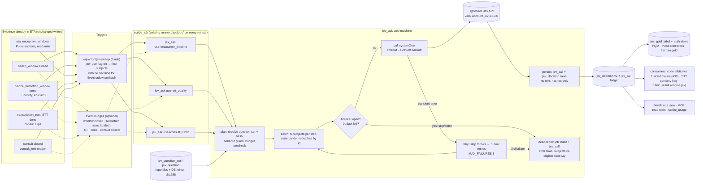

# Jev worker in Even Scribe / ETA: joint plan (draft)

| | |
|---|---|
| Date | 10 Oct 2026 (IST) |
| Owner | Vinay (V) |
| Builders | Claude builder team (ETA repo) |
| Authors | **Designer** (Grok Bot, Scribe-side architecture: this half) · **CAA** (Clinical Audio Analysis: the question-set and eval sections, placeholders below) |
| Code base | ETA `vinaybhardwaj-commits/Even-Transcription-Assistant`, `main` @ **`d94e724`** (`d94e724301647a0f38b0bc843ba769104eb58a1b`, committed 10 Oct 11:12 IST, freshly fetched). The Scribe MCP reports live = `99484f9`; the live build may lag `main`. |
| Related | Architecture PR [#34](https://github.com/vinaybhardwaj-commits/Even-Scribe-Architecture/pull/34) (`prd/2026-10-09-nemotron-production-encounter-timeline.md`, branch `docs/prd-nemotron-production-encounter-timeline` @ `20d4039`), epic [#23](https://github.com/vinaybhardwaj-commits/Even-Scribe-Architecture/issues/23), issues #25–#33 (#24 duplicates #25), `/workspace/eta-nemotron-jev-encounters-2026-10-09.md`, CAA's `/workspace/jev/JEV-QUESTION-GUIDE.md`, `/workspace/jev/JEV-PITCH-COMPARISON-2026-10-10.md`, `/home/box/shared/eta-bus/NEMOTRON-PRIMER-AND-JEV-PLAN-2026-10-10.md` |
| Status | Draft for builder. CAA sections merged verbatim 10 Oct ~12:10 IST. Conflicts with PR #34 / epic #23 resolved in **§16** (§16 wins over any earlier Scribe-side line it contradicts). **The text lane (§16.2) needs Vinay's GO.** Read-only work: no invoke or write MCP call, Pulse not touched. |

**How to read this.** A `path:line` is ETA `main` @ `d94e724` unless marked otherwise. **[inferred]** marks a proposal or inference not verified in code. **PROVISIONAL** marks a number that a bench run or a ruling must confirm. There is no patient data here: only ids, counts, times and scores.

**Evidence gathered for this draft (all read-only):**
- Code read of ETA `main` @ `d94e724`.
- Scribe MCP read tools: `scribe_jev_decisions`, `scribe_jev_signals`, `scribe_help`, `scribe_usage`.
- Two read-only catalogue/aggregate queries on the ETA Neon DB (`eta-app-db`): table privileges for the `brain_svc` role, and row counts of `jev_decision` / `jev_window_signal` grouped by question, prompt version and model. No row content was read.

---

## 1. Purpose and scope

**Purpose.** Turn TypeSafe Jev (`jev-1.13.0`) into one shared, versioned and calibrated **worker inside ETA**. Every Scribe use that wants a typed judgment on text or on a derived timeline then rides the same rails: the same queue, question-set registry, decision log, cost ledger, failure handling and calibration hooks. Today each use builds its own (§2).

**What Jev is (given).**
- Text-only. It answers typed questions (Choice, Score, Noul/yes-no) with probabilities.
- About 0.2 s per call, and cents per thousand calls: $0.042 per M input tokens. Output tokens are not billed (`lib/jev/counters.ts`).
- V has a ZDR, PHI-approved TypeSafe account.

**Rules (ETA v3.1, binding on every use).**
1. Acoustics judge sound. Jev reads only text or derived timelines.
2. Jev may veto, but never performs a destructive step. Code arbitrates every action.
3. A `prompt_version` on every answer. In this plan it becomes a question-set version plus a content hash.
4. Each use goes **bench → shadow → its own flag**.
5. Confidence bands are set per use.

**In scope: three starting uses.**
- **U-A: encounter boundaries and doctor ID before STT.** Input is Nemotron turns plus Pulse anchors. Delivered **through epic #23 / PR #34**, not redesigned here.
- **U-B: STT quality gating, and the Whisper-vs-Sarvam pick** (consult clips only, see §11).
- **U-C: per-consult rubric scoring.** Surgical pitch, chair affect, and whether each doubt was answered.

**Out of scope.**
- Anything a clinician sees, until a per-use flag and a V ruling.
- Changes to capture, STT routing defaults, the consult cutter, or Pulse code. Pulse data is only *read* as truth or anchors, through existing ETA tables.
- Question wording, rubrics and calibration method. These belong to CAA (§§ CAA placeholders).

---

## 2. Current state (ETA `main` @ `d94e724`)

### 2.1 Jev library (`lib/jev/`)
| Piece | Where | Facts |
|---|---|---|
| Client | `lib/jev/client.ts` | Raw fetch to `https://api.typesafe.ai/v1/systemone` (`:27`). Model = `req.model ?? ETA_JEV_MODEL ?? "jev-latest"` (`:70`). Key = `TYPESAFE_API_KEY ?? ""` (`:72`). Timeout `ETA_JEV_TIMEOUT_MS`, default 15 s. 3 attempts with backoff on 429/529 only; 401 and 422 are never retried. A 100k-character state guard. Metadata-only `llm-trace` with `surface:"jev"`. |
| Flags | `client.ts:65,177` | `ETA_JEV_ENABLED` unset → `JevDisabledError` **before** any fetch. `ETA_JEV_MOCK` on → deterministic mock (`lib/jev/mock.ts`, model string `"jev-mock"` **unless the caller passes `model`, in which case the mock echoes it**: `mock.ts:57`). |
| Entry point | `lib/jev/ask.ts:100` `askJev(state, asks[], opts)` | One `systemOne` call per batch (fan-out). Questions resolved from the registry by `(question_id, prompt_version)`. Off-menu choices rejected (`isValidChoice`). Confidence band. In-process counters. Persists to `jev_decision` unless `persist:false` (bench). |
| Registry | `lib/jev/registry.ts` | An in-code `Map` filled by module-load side effects (`registerJevQuestion`). No content hash, no status, no DB mirror. |
| Prompt versions | `lib/jev/prompts/*.ts` | `jev-arm-d-v1` (`arm-d-v1.ts:23`: phase, start, end, clinician, clinical, per window); `u1-phase-w1`, `u2-boundary-v1`, `u6-kind-v2` (`encounter-v1.ts:24-29`, E-6 fusion); `jev-role-v1` (`role-v1.ts:12`); `jev-note-safety-v1` (`note-safety-v1.ts`, U4/U8). |
| Bands | `lib/jev/confidence.ts`, `lib/jev/thresholds.ts` | Default act ≥ 0.9, caution ≥ 0.5, else review. Per-ask override exists. Arm D thresholds `ETA_JEV_T_*` read from env. |
| Cost | `lib/jev/counters.ts` | `JEV_INPUT_TOKEN_COST_USD = 42e-9`. **In-process only**: it resets on redeploy and is not aggregated across instances. No durable cost ledger. |
| Bench | `lib/jev/bench.ts` | Pure scorer (recall, precision, ECE, cost, latency) over `askJev(..., {persist:false})` output. |
| Errors | `lib/jev/safe-error.ts`, `lib/jev/types.ts` | `JevHttpError` (status + provider code only; body non-enumerable), `JevBadResponseError`, `JevDisabledError`, `JevStateTooLargeError`. **Any other error collapses to `jev_error: <Error.name>`** (`safe-error.ts:13`). |

### 2.2 Stores
| Table | Migration | Shape and notes |
|---|---|---|
| `jev_window_text` (J0) | 0105 | `window_id PK → bench_window`, `english` (nullable), `source ∈ run_english/native_en/translated/empty/not_ready/failed`. Written by job kind `jev_english`. |
| `jev_window_signal` | 0106 | One row per window: `phase, phase_probs, phase_confidence, p_start, p_end, p_clinician, p_clinical, model, prompt_version, batch_id`. Arm D only. |
| `jev_role_signal` | 0107 | Arm D role, per speaker cluster per window. |
| `jev_decision` | **0116**, CHECK widened in 0118 (`probe`) | `id, subject_type ∈ {window, turn, note_sentence, encounter, collapse, probe}, subject_id (no FK), question_id, prompt_version, model, answer jsonb, probabilities, confidence, latency_ms, input_tokens, created_at`. **Upsert** on `(subject_type, subject_id, question_id, prompt_version)`, so a re-ask overwrites. No text column (good). **Missing:** question-set hash, job/call id, cost, output tokens, mock marker, state hash, evidence links, error rows. |

**What is in production now** (read-only aggregate query, 10 Oct):
- `jev_decision`: **5,672 rows**, all `subject_type='probe'` (E-6 shadow-v2). That is 1,418 each of `u1_phase@u1-phase-w1`, `u6_kind@u6-kind-v2`, `u2_start@u2-boundary-v1` and `u2_end@u2-boundary-v1`, all with model `jev-1.13.0`. They were written between **23 Sep 17:04 IST and 24 Sep 21:19 IST**.
- `jev_window_signal`: 67 `jev-arm-d-v1` rows (22 Sep 06:50–06:53 IST) and 165 `skipped:no_english` rows.
- **No Jev decision has been written since 24 Sep 21:19 IST.** **[inferred]** `ETA_JEV_ENABLED` is off on the deployment, consistent with PLAN-v3.2 §0 "All Jev flags OFF" and with E-7 replays having run Jev only in a local replay process (per the 9 Oct read). I did not read env values.
- The provider answered `jev-latest` with `jev-1.13.0`. So the endpoint and model name in the code are **working**, and the model is not pinned in code.

### 2.3 Job queue and runner
- Queue table `scribe_job` (mig 0082). A kind is a **step machine** (`lib/jobs/types.ts`).
- Per-step contract: steps under `MAX_STEP_MS` 200 s, a lease of 240 s, `MAX_FAILURES` 3 (lifetime), resumable, idempotent, no transcript text in `progress`.
- Runner: `lib/jobs/runner.ts` via cron `/api/jobs/run` every minute (`vercel.json`). It claims ≤ 3 jobs per invocation, one at a time, with `FOR UPDATE SKIP LOCKED` (`lib/jobs/store.ts:142-151`).
- Kinds (`lib/jobs/kinds/index.ts`): `transcribe_range, stitch, route_transcribe, room_window, diarize_window, nemotron_identity, pulse_doctor_voice, emotion_window, jev_english, jev_window, jev_role, sarvam_transcribe, sarvam_translate, rubric_run, rubric_bench` + stubs.
- Every kind must declare `roomData` and a `heldOut` guard for blind room-days. This is asserted at load (`assertHeldOutDeclared`).
- Existing hooks we reuse:
  - `dedupeOn`: open-job dedupe.
  - `precheck` / `capPlan` + `insertJobCapped`: an advisory-locked daily call cap. Today it serves only the `llm_zdr` rubrics (`lib/rubrics/llm-cap.ts`, `lib/jobs/store.ts:~93`).
  - `withProgressPatch`.
- Jev job kinds today:
  - `jev_english` (J0): builds English text per window.
  - `jev_window` (Arm D): batches of `ETA_JEV_BATCH_WINDOWS`, 2 context windows, in-flight caps `ETA_JEV_MAX_INFLIGHT_PER_JOB`=2 and `_GLOBAL`=4. The caps are **per module instance**.
  - `jev_role`.
- Other Jev callers outside the queue:
  - `lib/encounter-clock/shadow-v2.ts` (E-6).
  - `lib/jev/note-safety-shadow.ts` (U4/U8).
  - `lib/room-access/clinical-route.ts` (U6).
  - `scripts/jev-u6-bench.ts`.

### 2.4 Adjacent frameworks the worker should reuse, not duplicate
- **Rubrics** (`lib/rubrics/`, `rubrics/<id>/rubric.json`, mig 0139 `rubric_run` / `rubric_result`).
  - The rubric schema already lists engine **`jev`** with typed `questions` (`lib/rubrics/types.ts:12,31-33`).
  - But `canRun` refuses every engine except `code` and wired `llm_zdr` (`lib/rubrics/registry.ts:59-64`). The EVR engine has an unwired `jevJudge` hook (`lib/rubrics/engines/evr.ts:27`).
  - `consult_surgical_pitch` (1.1.1) and `consult_chair_affect` (1.1.0) are `llm_zdr`, `draft`.
- **Nemotron (epic #23)** has moved since the 9 Oct read:
  - Mig `0140_diarize_nemotron.sql` / `0141` and job kind `nemotron_identity` are on `main`.
  - `lib/encounter-clock/timeline.ts` and `anchors.ts` exist.
  - Status per issue is not re-audited here.
- **STT** (`lib/stt/`):
  - `routing.ts` (engine per stage × language bucket).
  - `o4-scope.ts`: **room audio never goes to Sarvam** (V, 8 Oct).
  - `hallucination-collapse.ts`, `transcript-quality.ts` (heuristic flags), `wer.ts`, the leaderboard.

### 2.5 Root cause: `scribe_jev_decisions` answers `degraded: jev_error`

**Observed (10 Oct, read-only):**
- `scribe_jev_decisions {limit:5}` → `{"decisions":[],"degraded":true,"error":"jev_error: error"}`.
- `scribe_jev_signals {room_day_id:"rd_nonexistent_probe"}` → the same `jev_error: error`.
- `scribe_usage` shows 2 of 2 calls to `scribe_jev_decisions` errored in the last 14 days.

**It is not a Jev, key, endpoint or model problem.** `scribe_jev_decisions` never calls TypeSafe. It is a pure DB read. The 5,672 stored rows show `jev-1.13.0` answered fine via the current endpoint.

**Root cause: a Postgres permission error on the wrong DB role, mislabelled as a Jev error.**
1. `scribe_jev_decisions` → `listJevDecisions` (`lib/room-access/tool-reads.ts:43`).
   - It runs through `query` from **`@/lib/brain/db`** (`tool-reads.ts:6`). That is the brain pool on `BRAIN_DATABASE_URL`, i.e. role **`brain_svc`** (mig 0053 header).
   - It does not use the app handle `sql` from `@/lib/db` (`APP_DATABASE_URL`, owner), which the neighbouring reads in the same file use.
   - `scribe_jev_signals` does the same inline (`lib/mcp/tools/jev.ts:26,115`).
2. `jev_decision`, `jev_window_signal`, `bench_window` and `room_diarize_window` are **app-owned with no grants**.
   - Mig 0116 says "App-owned: no GRANTs". Migs 0057 and 0074 say `brain_svc` is "deliberately granted nothing".
   - **Measured** via `has_table_privilege`: `brain_svc` SELECT is **false** on `jev_decision`, `jev_window_signal`, `jev_window_text`, `bench_window` and `room_diarize_window`. It is true on `room_day`.
   - So Postgres raises `permission denied for table …` (SQLSTATE 42501).
3. The Jev MCP `failSafe` wrapper (`jev.ts:36-45`) routes every thrown error through `safeJevErrorMessage`.
   - That function only passes its own Jev error classes through. Anything else becomes `jev_error: <e.name>` (`safe-error.ts:13`).
   - The Neon/pg `DatabaseError` has `name === "error"` **[inferred from pg-protocol driver behaviour; the literal string `jev_error: error` matches it]**. Hence `jev_error: error`.
   - The registry `failSafe` (`lib/mcp/registry.ts:149-160`) then wraps it as `{degraded:true}`.

**Fix (P0, §13):**
- **(a)** Move both reads to the app handle `sql`, like `windowDetailRow` in the same file. Keep the held-out SQL unchanged.
  - Do **not** grant `brain_svc` SELECT. Migs 0057, 0072 and 0074 deliberately keep that role off bench and Jev tables.
- **(b)** Stop labelling DB faults as Jev faults. In the Jev MCP `failSafe`, map a driver error with a SQLSTATE to `db_error: <sqlstate>`. This is a closed code, so it is still text-safe.
- **(c)** Sweep the other `@/lib/brain/db` readers for the same wall: `lib/mcp/tools/{bench,voice,stores,fuse,fuse-report}.ts`, `lib/room-access/brain-state.ts`. A static test should pin which tables the brain pool may touch: `cue`, `room_day`, `visit`, `speaker_cluster`, `room` per 0053, plus anything granted later.

**Separately, for real Jev calls:**
- `client.ts:72` sends `Bearer ` with an empty key when `TYPESAFE_API_KEY` is unset. That surfaces as an opaque `jev http 401`. The worker adds a typed `config_missing_key` check before the fetch (§9).
- Pin `ETA_JEV_MODEL=jev-1.13.0`, so a provider bump of `jev-latest` cannot change answers silently.

---

## 3. Architecture

### 3.1 Placement decision: an in-ETA job kind family on the existing queue, not a new service
The code argues *for* the queue:
- Jev calls are about 0.2 s and stateless. One step can make hundreds of calls well inside `MAX_STEP_MS`.
- The runner already gives leases, retries with a failure cap, dedupe, held-out guards, a capped insert for daily budgets, MCP submit and audit.
- A separate service would duplicate all of that, and it would need the DB credential and key handling that ETA already owns.

**Known limits, and how they are handled:**
- Minute-granularity latency (cron every minute). That is fine for every use here, since none is real-time.
- Per-instance in-memory semaphores. They are replaced by a DB-backed budget and breaker (§9, §10).

**[inferred]** A separate service would only be justified if a use needed sub-second, in-request answers (none does), or if call volume outgrew the 3-jobs-per-minute runner. At about 0.2 s per call and batches of 50–200 calls per step, it does not.

### 3.2 Components
- **Question-set registry** (§4): repo files are the source of truth, mirrored into the DB with a content hash.
- **Sweeper** (`/api/cron/jev-sweep`, every 5 min, PROVISIONAL): for each use whose flag is on, it finds subjects whose evidence is ready and that have no decision under the *current* question-set hash. It enqueues `jev_ask` jobs, deduped. This mirrors the existing `diarize-windows` and `emotion-windows` crons. The sweeper is the primary trigger because it is idempotent and catches misses.
- **Event nudges [inferred]**: optional, cheap `submitJob` calls fired after a trigger point (§3.4), wrapped so a failure is swallowed and logged. They only reduce latency; the sweeper guarantees completeness.
- **`jev_ask` job kind** (generic): args `{use, question_set_id, version, subject_type, subject_ids[] | sweep_cursor, mode: bench|shadow|live, order_balance}`. Steps: `plan → ask (batch) → … → finish`.
- **State builders** (pure, one per use): subject id → Jev state. They re-fetch evidence by id at each step and never put text in `progress`.
- **Decision store** (§5), **call ledger and budget** (§10), **breaker** (§9), **calibration hooks** (§6).
- **Surfaces** (§11): Bench ops view, MCP read tools, `scribe_usage` section.

### 3.3 Diagram


### 3.4 Triggers per use
| Use | Trigger (evidence ready) | Subject | Notes |
|---|---|---|---|
| U-A encounter timeline | **Nemotron turns landed** for every window overlapping a segment, **and** anchors loaded (`anchors.ts`). Gaps use the "window closed + 15 min" sliding segment | `encounter` with id `tl_<room_day_id>_<anchor_start_ms>` (PR #34 §6.6 contract; kept to avoid churn) | Pre-STT. The state is the timeline (no text). Owned by epic #23 ticket (f) #30 |
| U-B STT quality | **STT done** for a consult clip (a `transcription_run` row reaches terminal). For the engine pick: **both** engine runs terminal | `stt_run` (single run) and `stt_pair` **[inferred]** (two runs on the same clip) | O4: Sarvam only on consult clips / doctor-app encounter audio, never room windows |
| U-C consult rubric | **Consult closed**, with a consult span and transcript available through the `consult_text` reader | `consult`. For per-doubt items: `doubt` (`<consult_key>#d<n>`) **[inferred]** | The agent (llm_zdr) enumerates doubts. Jev classifies each one (CAA guide, "list-type items") |

### 3.5 Worker lifecycle (`jev_ask`)
1. **Claim.** The runner claims the job (lease 240 s). The first step runs the `heldOut` guard (blind room-days refused by name).
2. **Plan.** Resolve the question set by `(id, version)`, then:
   - verify that the DB mirror hash equals the hash of the deployed file;
   - verify the status allows the requested `mode` (draft → bench only; `shadow` needs status ≥ shadow; `live` needs status `live` **and** the per-use flag);
   - run the budget precheck;
   - write the subject ids into `progress`.
3. **Batch.**
   - Each `ask` step takes up to `JEV_ASK_BATCH` subjects (PROVISIONAL 50).
   - For each subject, the state builder re-fetches evidence and builds the state. A state over the size guard becomes a typed `state_too_large` decision row (no call).
   - The step makes **one systemOne call per subject per option order**, with all of the subject's questions fanned out. Every Choice is asked forward + reversed and averaged (CAA principle 4). The exact option order sent is logged for every call (§16.1 item 4).
4. **Call.**
   - Breaker check, then the client.
   - The timeout and 429/529 backoff stay inside the client.
   - A per-step concurrency of 4 (PROVISIONAL), via a DB-backed slot count rather than module memory.
5. **Persist.**
   - One `jev_call` row per call.
   - One `jev_decision` row per (subject, question, order variant).
   - Idempotent on the decision key, so a replayed step is harmless (step contract #3).
6. **Retry.**
   - A transient class (§9) throws, so the runner retries the step. `withProgressPatch` keeps completed subjects.
   - A non-transient class (`schema_rejected`, `off_menu`, `state_too_large`) is recorded on the subject and is **not** retried.
7. **Dead-letter.**
   - After `MAX_FAILURES` 3, the job fails. Its subjects remain "no decision for this hash", so the sweeper re-offers them once the breaker closes (backoff: not before the next day for a subject that failed 3 times; PROVISIONAL).
   - `jev_call` keeps every error row, so the dead letter is visible in MCP and Bench.

### 3.6 Job kinds
| Kind | Status | Purpose |
|---|---|---|
| `jev_ask` | **new (P1)** | Generic worker above. `use` selects the state builder and consumer |
| `jev_drift` | new (P1) | Daily per-use drift and calibration report (§6) |
| `jev_bench` **[inferred]**, or `jev_ask mode=bench` | new (P1) | Runs a frozen gold split, `persist:false` for decisions, but writes `jev_call` with `mode='bench'` so cost is still counted |
| `jev_english`, `jev_window`, `jev_role` | existing | Kept as is. Migrated onto `jev_ask` later, or retired by V ruling (open question 6). Not a P-blocker |

---

## 4. Versioned question-set storage

**Source of truth: repo files**, reviewed in PRs like `rubrics/<id>/rubric.json`:
- Path: `jev/question-sets/<id>/<version>.json` **[inferred path]**.
- Mirrored into the DB at deploy by an idempotent sync (a script or a first-request hook). That gives joins and status.
- The legacy in-code registry (`registerJevQuestion`) keeps working for existing prompt modules. A legacy `(question_id, prompt_version)` maps to a synthetic question set `legacy:<prompt_version>` so old and new rows share one view.

**Hash.** `sha256` over the canonical JSON (sorted keys, no whitespace) of the full set: every question's `type`, `instructions`, `criteria`/options in order, gates, and the `state_schema` id. **Every decision pins this hash.** A one-character wording change is a new hash, and has to be a new version.

### 4.1 `jev_question_set`
| column | type | notes |
|---|---|---|
| id | text | e.g. `u10-timeline`, `stt-quality`, `pitch`, `doubt` |
| version | text | semver or the CAA `vN` label (CAA decides; regex-checked) |
| use | text CHECK | `encounter_timeline`, `stt_quality`, `stt_pick`, `consult_rubric`, `legacy` |
| subject_type | text | one of the §5 subject types |
| state_schema | text | e.g. `timeline-v1`, `transcript-turns-v1`, `doubt-excerpt-v1` (the builder contract) |
| model_pin | text | `jev-1.13.0`; a model bump means a new version + re-bench |
| content_sha256 | text NOT NULL | canonical hash (above) |
| status | text CHECK | `draft` · `bench` · `shadow` · `live` · `retired` |
| bands | jsonb | per-question override allowed in `jev_question` |
| calibration_ref | text null | sha of the calibration artefact (CAA, §6) |
| created_by | text | `caa`, `designer`, `builder:<name>`, `v` |
| ratified_by / ratified_at | text / timestamptz null | required for `shadow` and `live` |
| created_at | timestamptz | |
| | | UNIQUE `(id, version)`; UNIQUE `(content_sha256)` |

### 4.2 `jev_question`
| column | type | notes |
|---|---|---|
| question_set_id, version | text | FK to the set |
| question_id | text | `^[a-z][a-z0-9_]{1,48}$` |
| kind | text CHECK | `choice`, `score`, `noul` |
| body | jsonb | the exact `JevQuestion` sent (instructions object, criteria/options). Question wording is not PHI. Options built per call (e.g. row ids) are declared as a template plus a builder name |
| option_order | text CHECK | `forward`, `reversed`, `both` (order-balanced) |
| gate_question_id | text null | code-side gating (CAA guide §3): a dependent answer is overwritten in code, and the raw answer is kept |
| escape_options | text[] | e.g. `insufficient_evidence`, `not_applicable` (required for Choice; build-time check) |
| bands | jsonb null | `{act, caution}` override |
| calibration | jsonb null | `{method: temperature|isotonic|none, params_sha}` |
| question_sha256 | text | per-question hash, so cached answers can be reused across versions (CAA guide, "reuse across versions") |
| | | PK `(question_set_id, version, question_id)` |

### 4.3 `jev_question_set_event` (audit)
`(question_set_id, version, from_status, to_status, actor, reason, at)`. Status moves only forward, except to `retired`. `shadow` and `live` require a `ratified_by`. Moving to `live` additionally requires the per-use flag (§7) to be on, which needs a deploy.

---

## 5. Decision tables

Generalise `jev_decision` **additively** (one new migration, next free number, currently 0143, to be re-checked against open PRs; idempotent; no grants; drift test on every CHECK), and add a call ledger.

### 5.1 `jev_decision` (widened)
Existing columns stay. Added:

| column | type | notes |
|---|---|---|
| subject_type | CHECK widened | + `consult`, `stt_run`, `stt_pair`, `doubt`. Keep `encounter` for U-A (PR #34) and `window`/`turn`/`probe` for legacy. **[inferred]** Use `turn` only for its existing dual use; timelines are `encounter`, so no new "turn-timeline" type is needed |
| question_set_id / question_set_version | text | null for legacy rows → backfilled as `legacy:<prompt_version>` |
| question_set_sha256 | text | **pinned on every new row** |
| order_variant | text | `fwd`, `rev`, `derived` (the order-averaged + calibrated row that consumers read). `prompt_version` also carries `+fwd`/`+rev` per CAA §2, so the existing unique key already separates orders |
| option_order_sha256 | text | hash of the exact option sequence sent (§16.1 item 4) |
| lane | text CHECK | `timeline` (no text) or `text` (§16.2) |
| answer | jsonb | unchanged: a closed-vocabulary `JevAnswer` (noul/choice/score) |
| probabilities | jsonb | unchanged |
| confidence, band | real, text | band computed with the set's bands at write time |
| calibrated_p | real null | calibrated probability of the chosen option, from the **order-averaged** distribution, never Jev's `confidence` field (CAA calibration §4). Filled when a calibrator exists |
| outcome | text CHECK | `answered`, `no_answer`, `off_menu_rejected`, `gated_overwritten`, `state_too_large`, `error` |
| call_id | text | → `jev_call.id` |
| job_id | text null | → `scribe_job.id` |
| mode | text CHECK | `bench`, `shadow`, `live` |
| model | text | as returned by the provider (already present) |
| latency_ms, input_tokens | int | existing; the apportioned share |
| cost_usd | numeric(12,8) | apportioned share of the call cost |
| evidence | jsonb | **ids only**: e.g. `{window_ids:[…], nemotron_row_ids:[…], anchor_key:"…", transcription_run_ids:[…], consult_key:"…"}` |
| state_sha256 | text | **HMAC-SHA256** of the state with a server secret (not a bare hash, so short PHI text cannot be confirmed by guessing) |
| mock | boolean NOT NULL default false | true for any mock answer (§9) |

Rules:
- **No transcript text, state text, note text or names in any column.** The `answer` and `evidence` JSON are validated against an allowlist (keys and closed values). A property test asserts that no string longer than 64 characters or containing whitespace sequences lands in `answer`/`evidence` **[inferred test design]**.
- New unique key: `(subject_type, subject_id, question_id, question_set_sha256, order_variant, mode)`. Re-asking the same hash overwrites (a stability rerun writes to `jev_rerun` **[inferred]**, or is held in the bench file). A new hash is a new row, so history across versions is kept. Today's key (by `prompt_version`) is kept as a partial unique index for legacy rows only.
- `scribe_jev_decisions` and `scribe_jev_signals` must use the app handle (P0).

### 5.2 `jev_call` (ledger, one row per systemOne call)
`id, job_id, use, mode, question_set_sha256, subject_count, question_count, model_requested, model_returned, http_status, error_class (§9), latency_ms, input_tokens, output_tokens, cost_usd, state_bytes, mock, breaker_state, created_at (IST day derived)`.

No body, no state and no key. This table is the cost ledger (§10) and the dead-letter record.

### 5.3 Read views
- `jev_decision_current`: the latest row per (subject, question) under the **live, else shadow** set of each use. This is what consumers read.
- `jev_cost_day`: `(ist_date, use, mode) → calls, tokens_in, usd, errors by class`.

---

## 6. Calibration hooks (Scribe side; method and thresholds are CAA's, §§ CAA)

### 6.1 `jev_gold_label`
| column | type | notes |
|---|---|---|
| id | text PK | |
| use, question_set_id, question_id | text | the question the label answers. The label is about the *subject*, so it survives a question-set version change when the semantics are the same |
| subject_type, subject_id | text | |
| label | jsonb | closed value (e.g. a choice code, a row label, a boolean, an ordinal level) |
| source | text CHECK | `human_v`, `human_adjudicated`, `pqm`, `pulse_end_click`, `agent_v0_1`, `nemotron_rules` |
| strength | text CHECK | `strong`, `weak` (e.g. a Pulse `url_clear` close is weak; an `endConsult` click is strong) |
| split | text CHECK | `dev`, `test`, `live_audit`. **Split by room-day**, never by window ([Bus #126] leakage) |
| label_set_sha256 | text | the frozen gold file the row came from |
| created_by, created_at | | |

No text, and no patient ids beyond the existing ETA subject ids. Labels from Pulse/PQM are derived by read-only joins, and **Pulse code is never touched**.

### 6.2 Truth joins (views, read-only)
- **U-A:** `jev_decision(encounter)` ⋈ `eta_encounter_windows` (Start/End click, `close_kind` from #31) ⋈ PQM `called_at`/`completed_at` (Metabase db 13, per PR #34 §11) ⋈ human gold boundaries. This reuses PR #34's T1/T2 truth sets; it does not redefine them.
- **U-B:** `jev_decision(stt_run|stt_pair)` ⋈ `stt_gold_window` (mig 0072) / WER from `lib/stt/wer.ts` ⋈ `hallucination-collapse` measures ⋈ the `transcript-quality` heuristic flag.
- **U-C:** `jev_decision(consult|doubt)` ⋈ `rubric_result` (agent `llm_zdr` scores) ⋈ human adjudicated gold (CAA's dev/test splits).

### 6.3 Per-use confidence bands
- Stored on the question set or question (§4). Applied at write time to `band`.
- `calibrated_confidence` uses the CAA artefact referenced by `calibration_ref`. Raw confidence is **uncalibrated** (CAA guide §5), and Nouls cluster at 0.4–0.7.
- **No fixed 0.9 threshold until a calibrator exists.** Uncalibrated answers band `review` or `abstain` only. `auto` bands come from the gold-set risk–coverage curve per question (CAA calibration §4; §16.1 item 3).
- **Consumers read `band` only.** An `act` band is honoured only in modes where the use's flag allows action. In shadow, every band is log-only.

### 6.4 Drift checks (`jev_drift`, daily, per use and question)
- Answer distribution vs a reference week (PSI; PROVISIONAL alert at > 0.2).
- Mean confidence, abstain/escape share, act-band share.
- Order-flip rate where order balancing is on.
- Agreement with truth where truth arrived (rolling 7 days).
- **Model string change:** alert if `model_returned` ≠ `model_pin`.
- Latency p95, cost per subject, error-class mix.
- Output goes to `jev_drift_report (ist_date, use, question_set_sha256, question_id, metrics jsonb, alerts text[])`, which MCP and Bench read. Ids and numbers only.

---

## Question sets & rubrics (CAA)

### 1. Principles (binding on every set)
1. **Jev judges closed questions only. Code handles counting, numbers, time arithmetic, enumeration and gating.** This follows TypeSafe's jaggedness doc for jev-1.13 and our own dev results.
2. **One request per subject, with every question of the set in that request.** The state is billed once and latency stays flat in question count: median 0.17 s, p90 0.21 s, max 0.47 s over 1,441 calls with 0 errors.
3. **Pin the model to `jev-1.13.0`.** Every calibrator and threshold is only valid for the model it was fitted on.
4. **Every Choice is asked in both option orders and the probabilities are averaged** before any decision is made. Reversing the order alone changed 28% of decider, 21% of reassurance and 17% of urgency labels on dev.
5. **Every Choice carries escape options.** It must have `insufficient_evidence`, plus `not_applicable` or a named item-specific equivalent recorded in the registry (`no_pitch`, `empty_room`, `no_cost_question`, `not_a_doubt`). Without one, Jev invents an answer: on an empty tape it gave "consult breaks down" distress at 0.91.
6. **Dependent items are gated in code, never by Jev.** Questions are evaluated in isolation. With no pitch, Jev answered "no" instead of choosing the N/A it was offered, and code gating alone added about 15 correct answers on dev.
7. **Questions, rules and option keys are always in English.** The transcript stays in its native script with an English gloss: `[mm:ss] ROLE: native text  [EN: gloss]`. English-only text lost 1–8 correct answers on dev. Translating the questions costs up to 13 points in published tests.
8. **Choice is the default form.** Choice with the definition written into its rules beat Noul on redefined binary items (95% vs 85% on dev). Composites built in code from Nouls were the weakest form twice (doubts in v6, urgency in v8b). Use a Noul only when we will tune its threshold on labels. Use a Score only when we need an expected value.

### 2. Question-set registry

A **question set (QS)** is one versioned manifest. It maps directly onto ETA's existing registry key `question_id@prompt_version` (`lib/jev/registry.ts`).

| Field | Example | Rule |
|---|---|---|
| `qs_id` | `QS-PITCH` | Stable name of the set |
| `version` | `9.0.0` | MAJOR when an option set or definition changes (labels stop being comparable). MINOR when wording changes but options don't. PATCH for non-semantic edits. Any bump changes the hash and needs the re-eval gate (calibration spec §6) |
| `prompt_version` | `qs-pitch-v9` | The string written to `jev_decision.prompt_version`. Order pairs register as `qs-pitch-v9+fwd` and `qs-pitch-v9+rev`, so the stored row records the order actually sent |
| `set_hash` | sha256 | Hash of the sorted per-question hashes, plus `model` and `gate_code_version` |
| `questions[]` | see below | Each entry: `question_id`, `form` (choice/noul/score), `options[]` with `{what, not, examples}`, `escapes[]`, `order_pair: true`, `gate` (the code rule that sets N/A), `q_hash` (sha256 of the canonical JSON actually sent, one per order) |
| `rubric` | `consult-surgical-pitch-v0.1` | A rubric id plus version is required. Every option maps to a rubric code through `rubric_map`, e.g. Jev `decline` → rubric `refuse` |
| `model` | `jev-1.13.0` | Pinned. `jev-latest` is rejected |
| `state_builder` | `transcript-v1` / `timeline-v2` / `doubt-excerpt-v1` | A named, versioned state format with a token-budget rule |
| `language` | `{questions:"en", state:"native+en_gloss"}` | Every call logs the consult's `lang_mix` bucket (en / hi / kn / te / mixed) and `transcript_source` (whisper / sarvam / mixed) for per-language reporting |
| `calibrators{}` | `cal-pb_risk_any@qs-pitch-v9-jev-1.13.0-2026-11` | One per question, fitted on the calibration split. It is invalid when `q_hash` or `model` changes |
| `thresholds{}` | `{auto:0.93, review:0.60}` | Per question, on **calibrated** p. These replace the global act 0.9 / caution 0.5 through the existing per-ask `thresholds` override in `askJev` |
| `readiness` | `ready_spot_check` / `second_scorer` / `research` | Per question. It controls what downstream code may do with the answer |
| `splits` | `split.json@a530608417f9` | The frozen dev / calib / test ids, with sha |
| `eval_report` | path | The report that passed the gate for this version |

**Call log, one row per order:** `request_id, model, prompt_version, q_hash, state_hash, input_tokens, latency_ms, full distribution`, and never the state text. A **derived row** (`derivation: order_avg+cal`) holds the averaged distribution, calibrated p, band and gate result. Downstream code reads only the derived row.

**Reuse:** Jev answers each question in isolation. A new version therefore re-runs only the questions whose `q_hash` changed and reuses cached answers for the rest. The manifest records which answers were reused.

**Gating (in code, after Jev answers, before banding):**

| Gate question | Condition | Effect |
|---|---|---|
| `stt_usable` (QS-STT-GATE) | `unusable_*` or `no_speech` | Every text set (PITCH, AFFECT, DOUBT) returns `abstain:stt_unusable`. `partly_usable` runs but sets a flag |
| `u10_kind` (QS-TIMELINE) | ≠ `consultation` | End, start and walk-in questions are set to `not_applicable` |
| `pitch_kind` (QS-PITCH) | not `surgery` (plus `procedure` if V rules it in) | The 8 pitch items, urgency and recovery are set to `not_applicable` |
| `recovery_discussion` | `none` / N/A | `recovery_appropriateness` = `not_assessable` |
| `cost_discussed` | `no` | `cost_answered` = `no_cost_question` |
| deterministic pre-gates | patient-side speech < 3 turns, or state over budget | Skip the call and abstain with a reason code. Never send it to Jev |

**Token budget:** state plus the longest question must stay under 32k tokens. Indic script runs about 0.7–0.9 tokens per character, English about 0.3–0.4. Our largest consult (27 min, Hindi, Sarvam) came to 28.9k tokens with 19 questions. The guard must estimate tokens by script; a flat character count is not enough (see the handoff notes).

### 3. Initial sets: summary

| Set | Unit (subject_type) | State | Questions | Frozen file today | Readiness |
|---|---|---|---|---|---|
| QS-TIMELINE | encounter segment (`encounter`) | timeline JSON (#29), **no text** | 9 (5 from u10 + 4 new) | none. Proposed as `u10-timeline-v2` inside the #30 wording trial | research |
| QS-STT-GATE | window or aligned span (`window`) | Whisper and Sarvam spans, native + EN, plus code feature buckets | 3 | none | research |
| QS-PITCH | consult (`encounter`) | transcript-v1 | 17 (gate + 16) | `questions-pitch-v8.json` / `v8r.json` (sha `c98c01c1…` / `8bb05dbc…`) | mixed, see §6 |
| QS-AFFECT | consult (`encounter`) | transcript-v1 (same request as PITCH) | 4 | inside v8 (distress / confusion / frustration / reassurance) | **research: not production-ready** |
| QS-DOUBT | doubt (`probe` or a new `doubt`) | `{doubt text, time, excerpt −45/+150 s}` | 4 (+1 proposed) | `questions-doubt-d8.json` / `d8r.json` (sha `df4bf6c8…` / `f61e682d…`) | mixed, see §8 |

PITCH and AFFECT share one state, so they go in one request and are registered as two sets. That keeps readiness and change control separate.

### 4. QS-TIMELINE: improvements to #30 `u10-timeline-v1`

**Purpose.** Infer consult end (mainly), start offset, segment kind, doctor voice, walk-ins, phone calls and whether the same or a new patient follows a gap, all from the #29 timeline. Jev's answers are inputs to `fusion-timeline`; code decides (#30 rule "Jev may veto, never perform").
**Inputs.** The #29 segment JSON only, with two state changes (below).
**Outputs.** One `jev_decision` row per question per order, plus the derived row. The normalised view in PR #34 §7.3 gains `start_offset`, `doctor_letter`, `walk_in`, `after_gap` and `abstain_reasons`.
**Slots into #30, not alongside it.** v1 stays as wording A in the #30 trial. These changes are wordings B and C, registered as `u10-timeline-v2`. The winner is picked on dev and confirmed on test (calibration spec §2). Fusion, the runner and storage stay as #30 specifies.

**Proposed diff to #30 / PR #34 §7.2–7.3:**

```diff
 ## State (§7.2)
-"anchor": {"start":"t+00:00","end_click":"t+mm:ss"|"none","end_weak":"t+mm:ss"|"none","next_start":…,"cap":…}
+"anchor": {"start":"t+00:00","end_click":"none","end_weak":"none","next_start":…,"cap":…}
+#   Jev never sees the clicks. They stay in fusion code (rank 1). Otherwise Jev's end on the
+#   T2 End-click subset is circular, and its value is in the missing-click consults anyway.
+"instructions": {context, question, rules}   # preamble per JEV-QUESTION-GUIDE §2, see below
+row: + "edge": true                          # a 15-min window edge falls in this row (letters may reset)
+#   Remove "edge" once speakers carry stitched room-day keys (primer §6.3).

 ## Questions (§7.3)
-u10_end_row     choice  all row t values + continues_past_segment + cannot_tell
+u10_end_row     choice  CANDIDATE rows chosen in code (≤12, below) + continues_past_segment
+                        + no_consultation_in_segment (N/A) + insufficient_evidence
+                        asked fwd (chronological) + rev (reverse-chronological); probabilities averaged
+                        trial arm A keeps all rows (v1), arm B uses candidates
-u10_end_signal  choice  doctor_alone_then_quiet | voices_leave_then_new_voice | long_silence
-                        | tape_or_mic_loss | end_click_consistent | cannot_tell
+u10_end_signal  choice  patient_side_voices_stop_doctor_alone | all_voices_stop_long_quiet
+                        | new_voice_arrives | tape_or_mic_loss | cut_by_next_start
+                        | not_applicable | insufficient_evidence
+                        tie rule: if patient-side voices stop and the doctor talks alone, choose
+                        patient_side_voices_stop_doctor_alone even if a quiet stretch follows.
+                        Explanatory only: fusion does not rank on it, but it is logged for the veto audit
-u10_late_start  noul    "Did the consultation start meaningfully later than the anchor?"
+u10_start_offset choice before_anchor | at_anchor (within ±1 min) | late_1_to_3_min | late_over_3_min
+                        | not_applicable | insufficient_evidence
+                        fusion: move start only if calibrated p(late_*) ≥ τ_auto AND no DOC+other speech before it
-u10_kind        choice  consultation | staff_or_admin | phone_call | empty_room | cannot_tell
+u10_kind        choice  consultation | multiple_consultations | staff_or_admin | doctor_alone_talk
+                        | empty_room | insufficient_evidence
+                        (phone_call is dropped until rows carry a phone feature: the state cannot show one)
+                        GATE: ≠ consultation → end/start/walk-in set N/A in code
+u10_doctor_letter choice letters with ≥10 s speech + no_doctor_voice + insufficient_evidence
+                        ASKED ONLY when no row has DOC (gate in code); compared against the
+                        "most speech + longest presence" heuristic (doc_inferred)
+u10_walk_in     choice  none | staff_brief_walk_in | companion_joins | next_patient_early
+                        | not_applicable | insufficient_evidence
+                        (party COUNT is computed in code from stitched letters with ≥3 s; Jev does not count)
+u10_after_gap   choice  same_party_continues | new_patient_party | doctor_alone_or_staff
+                        | not_applicable | insufficient_evidence
+                        ASKED ONLY when code finds a quiet run ≥60 s followed by speech inside the segment.
+                        "Same vs new patient". Research until stitching lands, because a letter reset looks like a new party
+u10_phone_call  choice  none | doctor_on_phone_mid_consult | phone_between_consults
+                        | not_applicable | insufficient_evidence
+                        PARKED until #29 adds a row feature `phone` (narrowband band-energy flag, primer §6.2)
```

**Candidate rows for `u10_end_row` (code, deterministic, at most 12, chronological):**
1. The last row containing any non-DOC letter first heard in the first 5 minutes.
2. Each row where speech goes from active to 0 for 2 or more rows.
3. The row before any `new_spk` that follows 60 s or more of quiet.
4. The row before `next_start`.
5. The last DOC row.
6. The last row before an `edge` reset.

Deduplicate, then pad with ±1 neighbour rows up to 12. This applies the guide's rule "extract candidates in code, let Jev pick" and replaces a 90-way choice made on `mm:ss` labels, which are numbers Jev handles badly.

**Instructions preamble (wording B):**
- **context:** This is a speaker-turn timeline of one outpatient room around the moment a doctor opened a patient's record (`t+00:00`). Each row is 30 seconds.
  - `DOC` is the room's doctor. Letters are other voices.
  - `null` means no evidence, not silence.
  - Examination silences of 1–4 minutes with the same voices afterwards are part of the consult.
  - The next patient's record opening (`next_start`) usually comes after this consult has ended.
- **question:** In which row does THIS patient's consultation end?
- **rules:**
  - The end is the last row where this consult's patient-side voices are still present with the doctor.
  - The doctor talking alone afterwards (typing, dictating, calling the next patient) is after the end.
  - A brief staff voice is not a new patient.
  - Choose `continues_past_segment` only if this consult's voices are still active in the last row.

The rule "the doctor alone afterwards is after the end" needs V's ruling (see the handoff notes).

**Dev/test agreement:** none yet. No Jev run exists on timelines: production has 1 October Nemotron row and this lane has no key.
**Readiness:** **research** for every question. `u10_end_row`, `u10_kind` and `u10_start_offset` are candidates for "second scorer" once they pass the gate in the calibration spec §8.

### 5. QS-STT-GATE

**Purpose.** Decide whether a transcript span is usable for the text sets, pick Whisper or Sarvam where both exist, and flag errors that change clinical meaning. This is a complement to WER, not a replacement.
**Inputs.**
- Per window, or per aligned span (about 15–30 s) where engines disagree: span text from each engine (native + EN gloss), ±1 span of context, and feature buckets computed in code (`repeat_ratio`: none / some / loop; `chars_per_s`: low / normal / high; `lang_id`).
- **Engine names are hidden.** The engines appear as `version_A` / `version_B`, with the assignment randomised per call and recorded server-side.
- Disagreement spans come from a code diff of the aligned outputs. Numbers, doses and dates are compared **in code**; Jev only judges the words around them.

**Outputs.** `stt_usable` per window (this drives the gate), `stt_pick` per span, and a `meaning_change` flag per disagreement span.

| question_id | Form | Options (escapes last) | Notes |
|---|---|---|---|
| `stt_usable` | Choice | `usable`, `partly_usable` (some spans garbled), `unusable_garbled`, `unusable_wrong_language`, `no_speech_text`, `not_applicable`, `insufficient_evidence` | The gate for every text set. Rules: hallucinated repeats count as garbled; a short window that is clean is still usable |
| `stt_pick` | Choice, order-balanced **and** A/B swap-balanced | `version_A`, `version_B`, `both_equivalent`, `neither`, `insufficient_evidence` | Four calls per span: 2 orders × 2 label assignments |
| `meaning_change` | Choice | `same_meaning`, `negation_flip`, `laterality_or_site`, `drug_or_procedure_name`, `other_clinical_change`, `non_clinical_difference`, `insufficient_evidence` | Negation flips were Jev's strongest category in the radiology study (AUROC 0.977). It was blind to typos and homophones (AUROC ~0.56), so code must not route spelling-only diffs here |

**Dev/test agreement:** none. There are no labels, and only 8 Sarvam clips exist in our 96-clip set.
**Readiness:** **research.** It becomes a gate only after the R-STT reference set exists (calibration spec §1) and `stt_usable` passes the gate. Until then the gate runs in log-only mode and does not block the text sets.

### 6. QS-PITCH: surgical-pitch v0.1 (Vinay's 10 Oct rulings)

**Purpose.** Second scorer for the v0.1 surgical-pitch rubric beside the LLM agent, which stays primary.
**Inputs.** transcript-v1, the whole clip (a pitch-window filter cost 4–10 correct answers on dev). Names are masked to `[name]` and digit runs to `[NUM]`.
**Outputs.** Per-item labels mapped to rubric codes, the per-clip composite `all_four` (computed in code from benefits AND risks under v0.1 AND alternatives AND timing), and headline rates per doctor.
**Rulings encoded (10 Oct):**
1. **Recovery burden is not a risk.** It is in the Choice rules and the option `not` text, with the excluded cases listed: time off, no lifting, rest, physio, diet, dressing, stay, soreness. Recovery has its own item, `recovery_discussion` (`none` / `mentioned_only` / `adequate` / `thorough_tailored`), plus `recovery_appropriateness`.
2. **Fear-based urgency:** `fear_based` / `urgent_clinical` / `explicitly_non_urgent` / `neutral_or_unstated`, with the tie rule ("not an emergency" plus a scare scenario = fear-based) and its contrast exclusions: a scenario told to explain why this patient can wait; a fear voiced by the patient; an honest finding for a test; a genuinely acute case.
3. **Per-doubt scoring is primary** and lives in QS-DOUBT. The clip-level `doubt_voiced` / `doubt_unanswered` Nouls (τ = 0.58) are kept only for continuity. Proposal for v9: retire them and compute the per-clip all-answered rate in code from the QS-DOUBT results.

Dev = 29 clips, scored against labels CAA adjudicated (v7 items: n 27–29; v8 items: 20 scorable pitches). Test = 67 clips (38 scorable pitches), run once, scored against agent labels.

| question_id | Form | Options (Jev → rubric) | Dev | Test agreement (κ) | Readiness |
|---|---|---|---|---|---|
| `pitch_kind` (GATE) | Choice | surgery, procedure_or_investigation, fragment_only, no_pitch, insufficient_evidence | 21/29 | 70% (0.55); AUROC 0.87 | ready with spot checks, **once V rules on investigations** (Jev calls 75 pitches vs the agent's 58) |
| `pb_benefits` | Choice | yes/no/N/A/insufficient | 23/29 | 67% (0.49) | second scorer |
| `pb_risk_any` (v0.1) | Choice | yes/no/N/A/insufficient | 95% (0.89) | 89% (0.75); 92% after adjudication | **ready with spot checks** (confirm every Jev "yes" for a month) |
| `pb_real_complication` | Choice | same | 90% (0.79) | 89% (0.75) | **ready with spot checks** (coincides with risk_any under v0.1; both kept) |
| `pb_alternatives` | Choice | same | 23/29 | 73% (0.59) | second scorer |
| `pb_timing` | Choice | same | 23/29 | 69% (0.46) | second scorer |
| `urgency` (v0.1, 4 codes) | Choice | fear_based / urgent_clinical / explicitly_non_urgent / neutral_or_unstated + escapes | 85% (0.75) | 63% (0.44); fear yes/no 84% (0.43) | **second scorer, screen only.** Jev over-calls fear (11 vs the agent's 4); the agent stays primary |
| `recovery_discussion` | Choice (ordinal) | none / mentioned_only / adequate / thorough_tailored + escapes | 95% (0.93) | 68% (0.57); 94% within one level; weighted κ 0.67 | second scorer. It calls `adequate` with no audible post-op course, so add the rule "only the course after the operation" in v9 |
| `recovery_appropriateness` | Choice | appropriate / minimising_or_misleading → `misleading_minimising` / overstated / no_recovery_discussion → `not_assessable` + escapes | 80% (0.0) | 85% (0.0) | **research.** Positives are too rare: κ 0, no signal |
| `nonsurgical` | Choice | yes/no/N/A/insufficient | 24/29 | 75% (0.62) | ready with spot checks |
| `uptake` | Choice | accept / hedge / defer / question / decline → `refuse` / unheard + escapes | 18/28 | 63% (0.48) | second scorer. v9 should add `cost_block`, since the rubric has a `cost` uptake code that Jev currently folds into `question` |
| `decider` | Choice (order-fragile) | patient / family / shared / unclear + escapes | 22/29 | 79% (0.66) | ready with spot checks (order-balanced only) |
| `teach_back` | Choice | none / partial / full + escapes | 26/29 | 88% (κ −0.02: rare positives) | second scorer (screen for rare partial or full) |
| `cost_discussed` | Choice | yes / no / insufficient | 27/29 | 90% (0.79) | **ready with spot checks** |
| `cost_answered` | Choice | answered / partial / not_answered / no_cost_question / insufficient | 19/28 | 72% (0.41); AUROC 0.86 | second scorer |
| `doubt_voiced`, `doubt_unanswered` | Noul ×2, τ 0.58 | n/a | 18/27 (in-sample τ) | 60% (0.36) | superseded by QS-DOUBT; retire in v9 |

**v9 candidates.** Each is a MAJOR or MINOR bump with the re-eval gate. Not run yet.
1. Align `pitch_kind` with v0.1 `recommendation_kind`: `surgery`, `therapeutic_procedure`, `investigation`, `conservative`, `referral`, `no_surgery`, `fragment_only` + escapes. Code gates the pitch items on surgery (plus therapeutic procedure if V rules it in).
2. The recovery "post-op only" rule.
3. Uptake `cost_block`.
4. Rename the recovery_appropriateness options to the rubric codes. Code mapping is acceptable until then.
5. Retire the doubt Nouls.

### 7. QS-AFFECT: chair-affect v0.2. **Not production-ready.**

**Purpose.** Text-side affect: distress, confusion, frustration and reassurance on chair-affect v0.2 anchors, including the anti-defaults ("not the dump bin", "a prompted okay is not high"). It is a research signal to compare against tonality v0 (WavLM floor plus emotion2vec+ peak), which reads the voice. Jev never sees audio. Fusion happens in code, and **text/voice disagreement is itself a review flag.** Per tonality v0, tonality never overrides these word-based labels.
**Inputs.** The same request as QS-PITCH. Rules: patient and attender lines only; ignore ASR garbage, staff and phone talk, and other consults in the clip; default `low` when there is no clear sign.
**Outputs.** Low / medium / high per axis, plus escapes. Doctor boards would lead with rates, never the modal label (v0.2 aggregation rule), but **no boards from Jev affect** until the bar below is met.

| question_id | Form | Dev (adjudicated) | Test agreement (κ) | Readiness |
|---|---|---|---|---|
| `distress` | Choice | 20/29 | 79% (0.43) | research |
| `confusion` | Choice | 17/29 | 51% (0.20) | research |
| `frustration` | Choice | 23/29 | 67% (0.30); AUROC 0.81 | research |
| `reassurance` | Choice (order-fragile) | 15/29 | 36% (0.12) | research |

Score-form affect was worse than Choice on dev (confusion 17 → 13, frustration 16 → 11). A Hindi distress miss at 0.97 confidence is on record. **Bar for leaving research:** clinician κ ≥ 0.5 on test for that axis, with Indic n ≥ 40.

### 8. QS-DOUBT: per-doubt classifier (after LLM extraction)

**Purpose.** v0.1 primary metric: the per-doubt "% answered fully" (and fully + clear), overall, by type and by doctor.
**Pipeline.**
1. **Extraction step (not Jev).** An LLM agent lists each doubt with a timestamp and a quote or paraphrase. Jev cannot enumerate items.
2. **Jev classifies each doubt** from `{doubt_text, doubt_time, excerpt −45 s / +150 s}`. Jev never sees the agent's coding or evidence. The −90/+240 s window was no better (within 1–2 points) and costs more.
3. Code aggregates per doubt, then per clip (secondary).

**Extraction recall and precision are measured separately**, against the clinician's own doubt list (calibration spec §1). Jev metrics cannot see a missed doubt.

| question_id | Form | Options | Dev n=64 (κ) | Test n=124 (κ) | Readiness |
|---|---|---|---|---|---|
| `doubt_type` | Choice | cost, recovery, risk, need_for_surgery, alternatives, timing, logistics, seriousness, other; **v9 adds `not_a_doubt` + `insufficient_evidence`** | 81% (0.79) | 81% (0.78) | **ready with spot checks** |
| `raised_by` | Choice | patient, family, unclear; **v9 adds `insufficient_evidence`** | 95% | 96% (0.73), agent-unclear excluded | ready with spot checks |
| `answered` | Choice | fully, partly, deflected_to_desk, ignored, insufficient_evidence | 78% (0.34) | 77% (0.42); "fully" yes/no 81% (0.46) | second scorer (screening flag) |
| `answer_quality` | Choice | clear_specific, vague, inaccurate_misleading, no_answer; **v9 adds `insufficient_evidence`** | 72% (0.40) | 57% (0.26) | **research.** Garbled ASR replies read as vague |

d8 breaks principle 5: `doubt_type`, `raised_by` and `answer_quality` have no `insufficient_evidence`. `not_a_doubt` also gives a free extraction-precision signal. Both are proposed for d9 under the gate.

## Calibration & evaluation spec (CAA)

### 1. Ground truth

| Reference set | Size | Sampling | Labels | Double-scored |
|---|---|---|---|---|
| **R-CONSULT** (PITCH, AFFECT, DOUBT) | **240 consults**, about 145 with a surgical pitch | Stratified by **doctor** (no doctor over 12%; at least 5 for each doctor with 10 or more consults a month), **language** (≥30% Indic: Hindi, Kannada, other; oversample Sarvam), **month** (≥3 months: Sep, Oct, Nov), transcript source and pitch / no pitch. Phase A = clinician scoring of the existing 96 clips (keeps the current split). Phase B = 144 new consults from Nov, which become the fresh test set | Clinicians score rubric v0.1 and chair v0.2, blind to agent and Jev, and **enumerate doubts themselves** with timestamps | **60 consults (25%)** scored by 2 clinicians independently, then adjudicated (V settles). Report inter-rater κ per item: it is the ceiling Jev is judged against |
| **R-STT** | 300 aligned spans from ≥40 consults with both engines | Oversample disagreement spans with clinical tokens (negation, laterality, drugs, numbers). At least 100 spans per major language | A bilingual clinician reviewer labels usable / pick / meaning-change | 60 spans |
| **R-TIMELINE T1** | every eligible PQM consult (#32 rules) | as #32 | PQM `called_at` / `completed_at` | n/a |
| **R-TIMELINE T2** | every `endConsult` close (38 clean so far, growing) | as #32 | real End click | n/a |
| **R-TIMELINE T3** (new) | 150 segments (75 dev / 75 test), **split by room-day** | Room (OPD1/3/4/5/6/7), mic (TONOR / C270), parties (2 / 3 / 4+), back-to-back vs gap, missing-End vs clicked | Listened labels: start and end (±10 s), kind, doctor letter, walk-ins, phone, same vs new after a gap | 30 segments |

**Why these sizes.** At 85% accuracy, n ≈ 200 gives a 95% CI of about ±5 points. n = 60 double-scored gives a κ standard error of about 0.08–0.10. 300 calibration-plus-test labels per question is the floor for isotonic regression.

**PQM caveat.** PQM times are queue clicks. Before PQM is used for errors measured in seconds, measure the PQM-vs-T3 offset distribution on T3 and correct for any systematic offset.

**Labelling cost** (the real cost driver): about 15–20 clinician-minutes per consult. R-CONSULT ≈ 60–80 hours, plus about 15 hours for the double-scored subset. T3 ≈ 10 minutes per segment ≈ 25 hours.

### 2. Splits and the test rule
- **Units.** Consults for PITCH, AFFECT and DOUBT, stratified by doctor; each doubt follows its consult. **Room-days** for TIMELINE, never windows: room-day leakage inflated scores in the ETA bus refuter.
- **Three frozen splits:**
  - **dev** (40%): wording tuning;
  - **calib** (20%): calibrators and thresholds only;
  - **test** (40%): run once per frozen version.

  Each split file is read-only and carries a sha (today: `split.json`, test sha `a530608417f9`; the 29 / 67 split is kept for v8). The calib split for R-CONSULT is cut from Phase B.
- **The test set is never tuned on.**
  - Tuning scripts refuse test ids; add a CI assert.
  - Test is run once per frozen version.
  - Test errors may be read only after the result is recorded.
  - Once a test item's errors are read and used to change wording, that item is **burned** for that question. It moves to dev, and the next month's fresh consults refill test.
- Dev numbers are reported only as "in-sample". The plan quotes **test** numbers.

### 3. Metrics per set

| Set | Primary | Also report |
|---|---|---|
| All Choice items | Accuracy on non-abstained items, plus **coverage**; Cohen's κ (linear-weighted for ordinal items: recovery level, affect, teach-back) | Macro-F1; confusion matrix; **escape recall** (truth = N/A or insufficient → Jev abstains); abstain rate |
| Rare-positive items (fear-based, appropriateness, teach-back partial or full) | Sensitivity and PPV with Wilson CIs | No κ when there are fewer than 10 positives |
| Calibration (every question) | **ECE** (15 equal-mass bins) and Brier, before and after recalibration | **Reliability curve**; AUROC of calibrated p for correctness; risk–coverage curve |
| Stability | Forward-vs-reversed agreement; rerun agreement on a 10% weekly sample | Probability jitter (expected 0.01–0.04) |
| **Per-language breakdown** | Every metric by `lang_mix` (en / hi / kn / mixed) and by `transcript_source` (whisper / sarvam) | Per doctor. Cells with n < 20 are flagged and never ranked |
| QS-TIMELINE | **Boundary error in seconds** for start and end: median, p90, % within ±30 s and ±60 s. Reported separately for missing-End consults (T1/T3) and clicked consults (T2) | `end_row` within ±1 row; `kind` accuracy and κ; veto and contradiction counts. E-7 recall and precision come from #32 |
| QS-DOUBT | Extraction recall and precision vs the clinician list (match = same consult, ±30 s, same concept), then per-doubt classification | % answered fully: Jev vs clinician vs agent |
| QS-STT-GATE | Precision and recall for `usable`; **sensitivity for negation flips** (target ≥ 0.90) | False-flag rate per 100 spans |

### 4. Per-question recalibration and thresholds
- **Input to calibrate:** the order-averaged probability of the chosen option (Choice or Score), or p itself (Noul). **Never Jev's `confidence` field**: it measures how concentrated the distribution is, not the probability of being right, and audits found it never beats max-p.
- **Method, by calib-split size per question:**
  - fewer than 150 labels → temperature or Platt (1–2 parameters);
  - 150–300 → Platt;
  - 300 or more → isotonic (top-label for multi-class).

  Fit per language bucket only when that bucket has 150 or more labels. Published audits support this: raw ECE 0.12 fell to 0.008 with isotonic, and a single fitted temperature fixed most miscalibration.
- **Bands** on calibrated p, set on calib from the risk–coverage curve and confirmed on test:

| Band | Rule | Ready with spot checks | Second scorer | Research |
|---|---|---|---|---|
| **auto-accept** | p ≥ τ_auto, where selective accuracy on calib ≥ the target | target **≥95%** selective accuracy, at coverage ≥ 50% | **none**: never auto-accepted | none |
| **human review** | τ_review ≤ p < τ_auto, or Jev disagrees with the agent at p ≥ τ_review | goes to the review queue | Jev raises a flag; agent or human decides | logged only |
| **abstain** | an escape option chosen, a gate failed, a pre-gate failed, or p < τ_review | counted, excluded from denominators, and tracked as drift | same | same |

- **Noul thresholds are tuned on labels, never assumed to be 0.5.** Nouls are underconfident and cluster at 0.4–0.7 (doubt τ was 0.58). This is also why a fixed 0.9 on the v1 `u10_late_start` Noul would rarely fire.
- **Storage.** The calibrator is a versioned artefact, `cal-<question_id>@<prompt_version>-<model>-<yyyy-mm>`, with a hash. ETA would need one hook: calibrate inside `askJev` **before** `confidenceBand`, then pass the per-question `thresholds`.

### 5. Drift monitoring and re-tune cadence

| Signal (weekly, per question) | Alert |
|---|---|
| Label distribution vs the reference month (PSI) | PSI > 0.2 |
| Abstain or escape rate | ±50% relative change |
| Mean calibrated p; share in the auto band | ±10 points |
| Forward-vs-reversed disagreement | > 1.5× the test-time rate |
| Gate pass rates (STT usable, pitch, kind) | ±10 points |
| Input mix: language, transcript source, tokens per consult, rooms and doctors | a new cohort over 20% of volume |
| Monthly clinician spot check: 20 auto-accepted + 10 review-band per set | accuracy below the test lower 95% CI for 2 consecutive months |

**Mandatory re-eval triggers:** a Jev model change (including any `jev-latest` move, so pin it); a rubric version change; an STT engine change (Sarvam rollout, Whisper config); a state-builder version change; any drift alert.
**Cadence:**
- Recalibrate monthly once 100 or more new labels have accumulated.
- Re-tune wording at most quarterly, on dev only.
- Draw a fresh test set every quarter from the newest month.

### 6. Change control
1. **Any change to a question's wording, options, rules, state builder or gate code means a version bump** (§2 of Question sets), a new `q_hash`, and a new `prompt_version`.
2. **Re-eval gate before go-live:**
   1. Dev run.
   2. Freeze, with hashes in the manifest.
   3. **One** test run.
   4. Non-inferiority vs the live version on test: no "ready" item loses more than 2 points of accuracy, and κ is not significantly worse.
   5. Forward-vs-reversed and rerun stability ≥ 90%.
   6. Calibrators refitted and ECE ≤ 0.05 for auto-band items.
   7. Report posted.
   8. Sign-off: **V** for rubric semantics, **CAA** for evaluation, **Designer** for wiring.
3. **Shadow for 1 week or more.** The new and old versions run side by side, and their disagreement is reported before the registry pointer moves.
4. **Rollback** means flipping the registry pointer back. Old answers stay keyed by their own `prompt_version`.
5. Unchanged questions reuse cached answers by `q_hash`. The manifest says so.

### 7. Cost (measured on `jev-1.13.0`, $0.042 per M input tokens; output is free)

| Measured (`calls.jsonl`, 10 Oct) | Calls | Input tokens | Cost |
|---|---|---|---|
| v7 pass (dev variants + final on 96 clips) | 663 | 7.24 M | **$0.30** |
| v8 / d8 update (rubric v0.1) | 783 | 3.47 M | $0.15 |
| **Project total** | **1,441** | **10.7 M** | **$0.45**; 0 errors; median 0.17 s, max 0.47 s |
| Per call: full pitch set, 19 questions, one order | — | median 10.9k, max 28.9k | $0.00046 median |
| Per call: v8 changed items only | — | median 6.3k | $0.00027 |
| Per call: one doubt, one order | — | median 2.6k, max 8.5k | $0.00011 |

| Projected (estimates) | Per unit | At 60 consults/day (current Pulse rate: ~483 anchors 2–10 Oct) | At 300 consults/day |
|---|---|---|---|
| PITCH + AFFECT, order-balanced | ~22k tokens ≈ $0.0009 | $0.06/day | $0.28/day |
| DOUBT (~2 doubts per consult, balanced) | ~10k ≈ $0.0004 | $0.03 | $0.13 |
| TIMELINE (≤20k-char ASCII state ≈ ≤6k tokens, balanced; **estimate**) | ≈ $0.0005 | $0.03 | $0.15 |
| STT-GATE (~10 spans × 4 calls × ~1.5k; **estimate**) | ≈ $0.0025 | $0.15 | $0.75 |
| **Total** | ≈ $0.004 per consult | **≈ $0.27/day** | **≈ $1.3/day (~$40/month)** |
| One full re-eval of a set on a 400-item test, balanced | | ≈ $0.40 | |

Jev spend is negligible. Clinician labelling time (§1) is the real budget line. Rate limits (80 req/s) are not a constraint.

### 8. Acceptance criteria per phase

| Phase | Scope | Exit criteria |
|---|---|---|
| **P0: Bench (now)** | Offline runs on the box (done for PITCH and DOUBT); u10 v1 vs v2 wording trial on T3 dev | Registry manifests for all five sets with hashes; model pinned; split files frozen; u10 trial on ≥75 dev segments with a test-run plan; v8 and d8 hashes recorded in a FROZEN file |
| **P1: Shadow in Scribe** | Designer wiring: order pairs, derived rows, gates in code, calibration hook; `persist` behind flags | Replaying the 96 clips reproduces box v8/d8 labels with ≥ 98% identity (the rest within jitter); every `jev_decision` row carries `prompt_version` and `q_hash`; no state text in logs; abstain reasons logged; u10 v2 runs on ≥5 room-days |
| **P2: Reference + calibration** | R-CONSULT Phase A (96) + Phase B (144); T3 150; R-STT 300 | Inter-rater κ reported per item; calibrators fitted; ECE ≤ 0.05 after calibration on "ready" items; per-language tables with Indic n ≥ 60; extraction recall ≥ 0.85 for doubts |
| **P3: Limited auto-accept** | Ready items only: risk_any, real_complication, cost_discussed, nonsurgical, decider, pitch_kind (after the ruling), doubt_type, raised_by | On clinician test, each item's accuracy ≥ 85% and κ ≥ 0.6 **and** within 0.1 κ of inter-rater κ; ≥95% selective accuracy at ≥50% coverage; no language bucket more than 10 points below English; 1 week of shadow agreement with the agent; V sign-off |
| **P3-T: Timeline** | u10 v2 as an input to fusion (#30 rank 2) | On T3 test and T1 missing-End consults, the A5 median end error beats A4 (rules, no Jev) by **≥ 30 s**, and the #34 §11 bar holds (A5 beats A3 by ≥ 60 s; precision ≥ A3; T2 no worse than A2 + 30 s); `end_row` within ±1 row ≥ 70%; vetoes < 15% of Jev ends; survives the shifted-anchor control |
| **P4: Steady state** | Second-scorer items promoted one by one; STT gate goes live as a gate | Drift dashboard live; monthly spot checks green for 2 months; each promotion goes through §6. AFFECT and appropriateness stay research until their own bar (QS-AFFECT; ≥ 10 clinician positives) is met |

---

## 7. Flags and rollout (per use)

| Flag | Default | Effect |
|---|---|---|
| `ETA_JEV_ENABLED` | existing (**off**, inferred) | Master switch. No call without it |
| `ETA_JEV_MOCK` | existing | Mock client. Rows marked `mock=true` (§9) |
| `ETA_JEV_MODEL` | **set to `jev-1.13.0`** | Pin |
| `JEV_WORKER_ENABLED` | off | Sweeper and `jev_ask` run at all |
| `JEV_USE_ENCOUNTER_TIMELINE` | off | U-A shadow. Works alongside PR #34's `ENCOUNTER_TIMELINE_SHADOW` (that flag governs fusion writes; this one governs Jev asks) |
| `ETA_JEV_TEXT_LANE` | off | **Master switch for every set that sends transcript text** (STT gate, PITCH, AFFECT, DOUBT). Consult clips only. **Needs V's GO** (§16.2) |
| `JEV_USE_STT_QUALITY` | off | U-B shadow. Requires `ETA_JEV_TEXT_LANE` |
| `JEV_USE_CONSULT_RUBRIC` | off | U-C shadow. Requires `ETA_JEV_TEXT_LANE` |
| `JEV_*_LIVE` (one per use) | off | Allows `mode=live` for a set whose status is `live`. Requires a V ruling |
| `JEV_DAILY_USD_CAP` | $5 (PROVISIONAL) | Hard stop (§10) |
| `JEV_DAILY_USD_SOFT` | $2 (PROVISIONAL) | Warn |

The rollout ladder for each use is **bench** (frozen gold, `mode=bench`) → **shadow** (all eligible subjects, log only) → **its own flag** (live, consumer reads `band`). Every step needs the CAA pass bar plus a V ruling.

---

## 8. Consumers (code arbitrates; Jev never performs)
- **U-A:** `lib/encounter-clock/fusion-timeline.ts` (PR #34 §6.6) reads `jev_decision_current` for `u10-*`. The acoustic veto rules and contradiction counts stay in code. The output is `encounter_hypothesis source='timeline'` (shadow).
  - Doctor ID comes from the ECAPA identity pass (#27).
  - A Jev `doctor_speaker` letter pick (CAA primer §3) is at most a **shadow hint** when no DOC match exists. It must never write `clinician_id`.
- **U-B:** writes an advisory `stt_quality_flag` / `engine_preference` (shadow table or `rubric_result`, **[inferred]**).
  - When live it may **veto** using a transcript for note generation (flag for review) or **prefer** one engine's run among those already produced.
  - It never deletes a run and never re-routes capture.
  - It never sends room audio to Sarvam (O4).
- **U-C:** wire the rubric engine `jev` (`lib/rubrics/registry.ts canRun`) so `rubric_run` calls `jev_ask` and writes `rubric_result` with `findings` as closed codes. The agent `llm_zdr` rubric stays primary until CAA's pass bar says otherwise.

---

## 9. Failure handling

### 9.1 Typed error taxonomy (`error_class` on `jev_call`; `outcome` on `jev_decision`)
| Class | Source | Retry? | Breaker counts? |
|---|---|---|---|
| `disabled` | `JevDisabledError` | no (job ends `skipped:disabled`) | no |
| `config_missing_key` | **new** pre-fetch check on `TYPESAFE_API_KEY` | no | no (alert) |
| `auth` | HTTP 401/403 | no | yes, opens immediately |
| `schema_rejected` | HTTP 422 | no (subject marked) | no (alert: question-set bug) |
| `rate_limited` | 429 after client retries | yes (step) | yes |
| `overloaded` | 529 / 503 after client retries | yes | yes |
| `provider_error` | other 5xx | yes | yes |
| `timeout` | abort on timer | yes | yes |
| `aborted` | caller signal | yes | no |
| `bad_response` | `JevBadResponseError` | yes (once) | yes |
| `state_too_large` | `JevStateTooLargeError` | no (subject marked; builder must chunk) | no |
| `off_menu` | `askJev` rejection | no | no (counted for drift) |
| `no_answer` | key missing in response | no | no (counted) |
| `budget_exceeded` | §10 | no (job ends; resumes next IST day) | no |
| `circuit_open` | breaker | no (deferred) | n/a |
| `set_not_allowed` | status/mode mismatch, hash mismatch | no | no (alert) |
| `persist_failed` | DB write | yes | no |
| `db_error:<sqlstate>` | any driver error on read paths | yes | no. **Never reported as a Jev error** (the P0 bug) |

Only allowlisted codes reach logs, traces, MCP and Bench (`safe-error.ts` discipline is kept).

### 9.2 Circuit breaker
- State lives in a DB row per use: `jev_breaker (use PK, state closed|open|half_open, opened_at, reason_class, consecutive_failures, window_errors, window_calls)`. Serverless instances share nothing in memory.
- **Open** when either holds (PROVISIONAL):
  - 5 consecutive breaker-counted failures;
  - an error rate ≥ 50% over the last 20 calls.
  - `auth` opens it at once.
- **Half-open** after 10 min: one probe call. Success closes it; failure re-opens it with doubled wait, capped at 2 h.
- While open, `jev_ask` defers (the job ends `circuit_open`, subjects stay pending), and the sweeper does not enqueue for that use.

### 9.3 Mock fallback, marked as such
- The mock runs only when `ETA_JEV_MOCK` is on, or under `JEV_MOCK_FALLBACK=1` while the breaker is open (bench and dev environments only; **forbidden when any `JEV_*_LIVE` is on**, asserted at boot).
- Every mock row: `mock=true`, `model='jev-mock'` (fix: the mock must **not** echo a caller's `model`, `mock.ts:57`), `band='review'`.
- Mock rows are excluded from `jev_decision_current`, truth views, drift and every consumer.
- MCP and Bench show the mock share in red.

### 9.4 Degraded surfacing
- MCP read tools return `{ok:false, degraded:true, error:<class>}` with an allowlisted class. A DB fault reads `db_error:42501`, never `jev_error`.
- `scribe_jev_health` **[new, read]** and the Bench view show breaker state, last error class, budget left, mock share and stale sweeper.

### 9.5 Never block capture or STT
- No Jev call sits inside any capture, upload, chunk, STT, diarize or note-generation request path. The worker is only queue jobs.
- Event nudges are fire-and-forget `submitJob` calls in a `try/catch` that only logs. A queue insert failure cannot fail the caller.
- Consumers treat "no decision" as "no opinion" and fall back to today's behaviour (acoustic clock, existing routing, agent rubric).
- A test asserts that the capture and STT routes import nothing from `lib/jev/` **[inferred test design]**.

---

## 10. Cost and rate limits

**Reference prices and volumes:**
- $0.042 per M input tokens (`counters.ts`, CAA measurements).
- CAA project total: 1,441 calls, 10.7 M tokens, about $0.45.

**Estimate [inferred, PROVISIONAL]:** about 12 rooms × about 30 consults a day.

| Use | Calls/day | Tokens/call | $/day |
|---|---|---|---|
| U-A | about 400 segments × 1 (×2 if order-balanced) | about 3–4k | about $0.07–0.13 |
| U-B | about 360 runs + about 100 pairs | about 8–15k | about $0.2–0.3 |
| U-C | about 360 consults × 2 orders + about 700 doubts × 2 | about 15k and about 2k | about $0.5 |

**Total: about $1/day.** The PROVISIONAL caps are $2 soft and $5 hard.

**Controls:**
- **Per-day budget.** `JEV_DAILY_USD_CAP` and optional per-use caps. Enforced at **submit** (capped insert under an advisory lock, reusing the `insertJobCapped` pattern, `lib/jobs/store.ts`) and at **each step** (sum of `jev_call.cost_usd` for the IST day, plus this step's reservation). When exceeded, the job ends `budget_exceeded`, the sweeper pauses that use until 00:00 IST, and an alert is raised.
- **QPS caps.** A per-step concurrency of 4 and a global slot count in the DB (PROVISIONAL 8 in-flight). The client's 429/529 backoff stays. CAA reports the TypeSafe rate limit as 80 req/s, so it is not a constraint; the caps exist for cost and blast radius.
- **Batching.** One call per subject with all questions fanned out (state billed once). Up to `JEV_ASK_BATCH` subjects per step. Per-question caching by `question_sha256` re-runs only changed questions.
- **Cost ledger.** `jev_call` rows plus the `jev_cost_day` view. The in-process `counters.ts` stays for logs only.
- **`scribe_usage`.** An additive `include:"jev"` option returns per use and IST day: calls, tokens, USD, error classes, breaker state and budget left. Output is unchanged when the option is absent.

---

## 11. Surfaces
- **Bench ops view** (`/admin/jev` **[inferred path]**, admin-only). One row per use:
  - flag state;
  - live and shadow question-set versions and short sha;
  - queue depth and oldest pending subject;
  - last success;
  - calls, USD today vs cap;
  - p50/p95 latency;
  - band mix (act/caution/review/escape);
  - error classes (24 h);
  - breaker;
  - mock share;
  - drift alerts.

  Drill-down shows decision counts per question. **Never text.**
- **MCP (read scope only):**
  - `scribe_jev_decisions`: **fix (P0)**. Then add filters `question_set_id`, `question_set_sha256`, `mode`, `since`, `mock`, and return the new columns.
  - `scribe_jev_signals`: fix (P0).
  - `scribe_jev_question_sets` **[new]**: registry read (id, version, use, status, sha, model_pin, questions with kind and options, bands, calibration_ref, ratification).
  - `scribe_jev_health` **[new]**: breaker, budget, sweeper lag, mock share, last error class per use.
  - `scribe_usage`: `include:"jev"` (§10).
  - Invoke tools (e.g. a `scribe_jev_ask` submit for bench runs) are **[inferred]**, require invoke scope, and come later.
- **Clinician-facing:** nothing until a use's `JEV_*_LIVE` flag is on **and** V rules. Even then the consumer shows its own product decision (e.g. "review this transcript"), never raw Jev probabilities.

---

## 12. PHI / ZDR notes
- **Account.** V's TypeSafe account is ZDR and PHI-approved. The key lives only in Vercel env `TYPESAFE_API_KEY`. It is never logged, traced, stored in DB rows, put in MCP output or posted to the bus (the existing client discipline). **[inferred]** Confirm the BAA/DPA scope covers all three uses and TypeSafe's processing region (open question).
- **What leaves ETA:**
  - **U-A:** the timeline only (relative times, segment letters, `DOC`/`?`, counts). By construction there is no PHI (PR #34 allowlist property test).
  - **U-B and U-C:** transcript text (native script plus `[EN:]` gloss per the CAA guide). This is PHI, allowed **only** through the text lane (§16.2) to the ZDR account, and only after V's GO. No names or ids are added to the state beyond what speech contains. No clock times, room names or consult ids appear in the state.
- **What stays.** Decisions, calls, gold labels and drift reports hold ids, closed codes, numbers and HMAC hashes. They never hold text. Evidence links are ids.
- **Held-out room-days.** Every `jev_ask` declares `roomData:true` with a `heldOut` guard. Blind days are refused at submit and at the first step. MCP reads keep the existing held-out SQL.
- **Bus and CAA.** CAA receives ids, decisions, counts and scores via MCP reads. It does not receive transcript text from ETA through this worker.
- **Role separation.** No new DB role. The worker writes through the app handle. `brain_svc` stays off Jev tables (P0 fix (a) keeps it that way).

---

## 13. Build plan (ticket-sized; each ticket goes builder → refuter; shadow first)

### P0: fix `jev_error` and smoke test (no Jev behaviour change)
| # | Slice | Acceptance criteria |
|---|---|---|
| P0.1 | `listJevDecisions` (`tool-reads.ts:43`) and the `scribe_jev_signals` query (`jev.ts:115`) move to `sql` from `@/lib/db`. The held-out SQL is unchanged | `scribe_jev_decisions {}` returns `ok:true` with 100 rows, newest first. Filtering `question_id=u1_phase` returns rows with `prompt_version='u1-phase-w1'`. `scribe_jev_signals` on a room-day with signals returns its rows. A blind room-day is still refused or filtered. A unit test fails if either function imports `@/lib/brain/db` |
| P0.2 | The Jev MCP `failSafe` maps driver errors to `db_error:<sqlstate>`. Jev classes are unchanged | A test with a fake `DatabaseError{code:'42501', name:'error'}` gives `db_error: 42501`. No provider text reaches the message (the existing W27.7 tests stay green) |
| P0.3 | Sweep the brain-pool readers. Add a static allowlist test of tables the brain pool may touch | A list of offenders is posted in the PR (or "none"), and each offender is fixed or ticketed. CI fails on a new brain-pool read of an app-owned table |
| P0.4 | `config_missing_key` check before fetch. The mock no longer echoes `req.model`. Set `ETA_JEV_MODEL=jev-1.13.0` (env change, V/ops) | A missing key gives a typed error with no network call (test). Mock rows always say `jev-mock` |
| P0.5 | Smoke test: an operator-run script (pattern of `scripts/jev-u6-bench.ts`) sends **synthetic, non-PHI** fixtures through `askJev(..., {persist:false})` with the real key on a preview or local env | 1 call `ok`, `model_returned='jev-1.13.0'`, latency < 1 s, tokens > 0. The output is numbers only, and a metadata-only trace row exists |

### P1: worker and storage
| # | Slice | Acceptance criteria |
|---|---|---|
| P1.1 | Migration: `jev_question_set`, `jev_question`, `jev_question_set_event`, `jev_call`, `jev_gold_label`, `jev_breaker`, `jev_drift_report`, plus additive `jev_decision` columns and widened CHECK. Idempotent, no grants | Applies twice cleanly. The CHECK drift test matches `JEV_SUBJECT_TYPES`. Legacy rows are backfilled with `question_set_id='legacy:<prompt_version>'`. The existing `askJev` path still writes |
| P1.2 | Question-set files, loader, canonical hash, DB sync. A legacy bridge for in-code prompts | The hash is stable across key order and whitespace (property test). A changed wording changes the hash. Sync is idempotent. A status move without ratification is refused |
| P1.3 | `jev_ask` kind (plan/ask/finish), state-builder interface, held-out guard, dedupe, persistence with hashes and HMAC, `withProgressPatch` | Replaying a step writes 0 duplicate decisions. No text in `progress` (test). The mock run writes `mock=true`. Draft sets run only in `mode=bench` |
| P1.4 | Breaker, taxonomy, budget (submit and step), DB slot count | Fault-injection tests per class (the §9 table). The breaker opens and half-opens as specified. The cap stops a running job and refuses submit, with an advisory lock (3 concurrent submits cannot overshoot) |
| P1.5 | Sweeper cron and optional event nudges, behind `JEV_WORKER_ENABLED` | Flag off: 0 jobs, 0 calls. On: each eligible subject gets exactly one decision per hash. A nudge failure never fails its caller (test) |
| P1.6 | MCP: `scribe_jev_question_sets`, `scribe_jev_health`, `scribe_jev_decisions` filters, `scribe_usage include:"jev"`. Bench `/admin/jev` v0 | All read scope. Outputs carry no text (snapshot test). Usage reconciles with `jev_call` sums |
| P1.7 | `jev_drift` daily kind | It writes a report per use and question. A model-string change raises an alert (fixture) |

### P2: U-A shadow via epic #23 (do not duplicate PR #34)
| # | Slice | Acceptance criteria |
|---|---|---|
| P2.1 | Register `u10-timeline` question set(s) from CAA's wording trial (PR #34 §6.6 / #30) as files, status `bench` | Bench report on about 40 V-labelled segments posted (PR #34 §13). Rows carry `question_set_sha256` |
| P2.2 | `timeline-v1` state builder = #29's `timeline.ts` output (and #31 anchors). The end-click/end-weak values are masked for boundary questions (CAA primer §3) | The allowlist privacy property test passes. Over-size segments become `state_too_large` rows, not calls |
| P2.3 | #30's `shadow-v3` reads Jev answers from `jev_decision_current`, produced by `jev_ask use=encounter_timeline`, instead of inline `askJev` | With `JEV_USE_ENCOUNTER_TIMELINE` on and `ENCOUNTER_TIMELINE_SHADOW` on, timeline runs exist for ≥ 5 room-days. If Jev is down, no run is written and the reason is `jev_disabled`/`circuit_open` |
| P2.4 | Gold from PQM / Pulse End clicks / V labels into `jev_gold_label` (derived, read-only) | E-7 (#32) reports A4 vs A5 with the shifted-anchor control. The pass bar is PR #34 §11 |

### P3: U-B STT quality gating and engine pick (shadow)
| # | Slice | Acceptance criteria |
|---|---|---|
| P3.1 | `transcript-turns-v1` state builder for `stt_run`, and for `stt_pair` on **consult clips only** (O4 asserted) | A room-window subject is refused `scope_consult_only` (test). No state is built for blind days |
| P3.2 | Register CAA's `stt-quality` / `stt-pick` sets. Run in shadow after STT done | Decisions exist for ≥ 3 clinic days. The truth join with WER / `stt_gold_window` / collapse metrics is reported by CAA |
| P3.3 | Advisory consumer (shadow table), compared with `transcript-quality.ts` flags | No change to routing, notes or the UI with the live flag off (byte-identical test) |

### P4: U-C per-consult rubric scoring (shadow)
| # | Slice | Acceptance criteria |
|---|---|---|
| P4.1 | Wire rubric engine `jev`: `canRun` admits `engine:"jev"` when the question set exists and `JEV_USE_CONSULT_RUBRIC` is on. `rubric_run` delegates to `jev_ask` | `rubric_bench` on CAA's frozen test split reproduces CAA's v8 numbers within rerun jitter. `rubric_result.findings` holds closed codes only |
| P4.2 | Per-doubt: the agent (`llm_zdr`) lists doubts with timestamps. The `doubt-excerpt-v1` builder (−45/+150 s excerpt) feeds Jev classification. Jev never sees the agent's coding | `doubt` subjects are linked to consult and agent run ids in `evidence`. The agent's coding is absent from the state (test) |
| P4.3 | Chair affect and surgical pitch as Jev second scorer next to the agent, with order balancing | Shadow on all closed consults for 1 week. CAA posts agreement and calibration. The agent stays primary |

---

## 14. Ownership split
| Area | Designer (product/architecture) | CAA (questions/rubrics/calibration/eval) | Claude builders |
|---|---|---|---|
| Worker placement, lifecycle, job kinds | **owns** | consulted | build |
| Storage schema (sets, decisions, calls, gold, drift) | **owns** | consulted on gold and calibration fields | build |
| Question wording, options, gates, state schema content | consulted (privacy/shape) | **owns** | implement builders to spec |
| Bands, calibration artefacts, drift thresholds, pass bars | consulted | **owns** | implement hooks |
| Failure taxonomy, breaker, budget, surfaces | **owns** | consulted | build |
| U-A timeline | via epic #23 / PR #34 | U10 wording trial, eval | #29–#32 |
| Rollout rulings (shadow, live) | proposes | proposes evidence | — (**V decides**) |

---

## 15. Open questions
1. **Read handle.** Confirm P0's choice (move reads to the app handle) over granting `brain_svc` SELECT. Migs 0057, 0072 and 0074 argue against grants.
2. **Is `ETA_JEV_ENABLED` off in production by intent?** No decisions since 24 Sep 21:19 IST. Turning on the worker needs the master flag on with all `JEV_USE_*` off.
3. **Subject type for U-A.** Keep PR #34's `encounter` + `tl_…` or add `timeline_segment`? Keeping it is assumed here.
4. **Re-ask semantics.** Overwrite per hash (proposed) or append-only history for stability reruns?
5. **TypeSafe limits and terms.** Account QPS and daily limits. Does a request id come back (to store in `jev_call`)? Processing region. Do the ZDR/PHI terms cover U-B/U-C transcript text?
6. **Legacy kinds.** Migrate `jev_window`/`jev_role`/E-6/U4/U6 onto `jev_ask`, or freeze them as legacy?
7. **Question-set source of truth.** Repo files plus DB mirror (proposed) vs DB-first with an operator write tool.
8. **U-B consumer.** May a live U-B ever *prefer* an engine for note generation, or only flag for review? This needs a V ruling and an O4 check.
9. **Budget numbers.** $2 soft / $5 hard per day and 8 in-flight are PROVISIONAL.
10. **Doctor ID from Jev.** Allow a shadow-only `doctor_speaker` letter hint when voiceprints fail (ruling 182), or keep identity purely acoustic?
11. **Doubt subject type.** `probe` or a new `doubt` (CAA ruling 14c; this plan assumes `doubt`).
12. **Consult end definition** (CAA ruling 14a): does the consult end when patient-side voices leave, or when the doctor finishes alone?
13. **Pitch denominator** (CAA ruling 14b): do investigations and therapeutic procedures count?
14. **Live vs `main`.** The MCP reports live `99484f9` and `main` is `d94e724`. P0 acceptance must be checked on the deployed build.

---

## 16. Reconciliation with PR #34 / epic #23

**Inputs.** CAA's handoff notes (10 Oct, PR #34 head `20d4039`, draft), the CAA sections above, and §§1–15. **Where this section contradicts an earlier Scribe-side line, this section wins.** Nothing here is posted to GitHub. §16.4 lists the follow-up comments to make.

### 16.1 Timeline lane (pre-STT, no text): decisions
1. **Model pin, everywhere.**
   - `ETA_JEV_MODEL=jev-1.13.0` on the deployment.
   - The question-set registry rejects `jev-latest`. `model_pin` is required on every set, **the u10 timeline sets included**.
   - `jev_drift` alerts if `model_returned ≠ model_pin`.
   - A model change is a mandatory re-eval (CAA calibration §5) and voids every calibrator.
2. **No End click in the Jev state.**
   - The timeline state sends `end_click:"none"` and `end_weak:"none"`. The `end_click_consistent` option is removed from `u10_end_signal`.
   - Clicks stay in fusion code (rank 1) and serve as **truth for scoring only** (T2).
   - The timeline builder (#29) gets a property test that no click time appears in a Jev state.
3. **No fixed 0.9 threshold until calibrated.**
   - PR #34's "Jev `end_row` at band act (≥ 0.9)" and the fusion `START_P`/`END_P` 0.9 run on raw `confidence`, which is a concentration measure. They are replaced by **per-question τ_auto / τ_review on calibrated p**, set from the T3 gold set (CAA calibration §4).
   - Until a calibrator exists, Jev answers band `review` or `abstain`. In shadow, fusion records "would have used Jev" counterfactually and does not rank on uncalibrated answers.
   - Builders add a calibrate-before-band hook in `askJev` (§13 P1.3).
4. **Option order against first-option bias.**
   - Every Choice is asked **forward and reversed** and the probabilities are averaged into a `derived` row (CAA principle 4). Per-call row options (`u10_end_row` candidates) are additionally **shuffled with a recorded seed** in stability audits **[inferred]**.
   - Every call logs the exact order sent: `prompt_version` `+fwd`/`+rev`, `order_variant`, and `option_order_sha256`.
5. **Phone / call signal: a gap today.**
   - #29 rows have no phone feature, so `phone_call` is dropped from `u10_kind` and `u10_phone_call` is parked.
   - Proposal: #29 adds a row flag `phone` from an **acoustic** narrowband band-energy detector (300–3400 Hz, codec artefacts; primer §6.2). This is computed by acoustics and only shown to Jev, keeping "acoustics judge sound".
   - Until it exists, this is a declared gap in the eval (phone calls are scored as `staff_or_admin` or `insufficient_evidence`).
6. **Stable speaker letters across windows.**
   - Letters are keyed by **room-day cluster id**: ECAPA/voiceprint stitching of Nemotron speakers across consecutive windows (cos ≥ 0.55 greedy one-to-one, running centroid; DOC by room centroid ≥ 0.65; primer §6.3). They are not keyed by (window, label).
   - The segment state shows letters derived from the stitched key (still no ids).
   - Until stitching lands, rows carry `edge:true` at 15-min window boundaries, and `u10_after_gap` / `new_spk`-driven signals stay **research**.
7. **90-row cap → windowing.**
   - The Jev segment is capped at **START − 60 s … min(next START, START + 30 min)** (≤ 62 rows).
   - A segment that is still open at +30 min gets a **second, overlapping segment** (+25 … +55 min), whose answers fuse in code (the later `end_row` wins only if the first says `continues_past_segment`).
   - Silent-run compression stays as a secondary guard. `too_large` becomes a typed abstain, never a silent drop.
   - `u10_end_row` uses **≤ 12 code-chosen candidate rows** (CAA §4) instead of every row.
8. **Wording trial sized properly.**
   - Use T3, **150 listened segments: 75 dev / 75 test, split by room-day**, stratified by room, mic, parties, back-to-back vs gap, and missing-End vs clicked.
   - Arm A = u10 v1, arms B/C = v2 wordings. Pick the winner on dev, run test once, and double-score 30 segments.
   - This replaces PR #34's "about 40 V-labelled segments". The P0 bench needs ≥ 75 dev segments with a test-run plan (CAA P0 exit).
9. **Timeline questions = `u10-timeline-v2` proposals onto #30.**
   - CAA §4's diff is registered as `u10-timeline-v2` (wordings B/C) **inside** the #30 trial, with `u10-timeline-v1` as arm A.
   - Fusion, the runner and storage stay as #30 specifies, except items 2, 3, 4 and 7 here.
   - All escapes per CAA principle 5. Gates in code (`u10_kind ≠ consultation` → N/A).

### 16.2 The text lane: separate from epic #23. **Needs Vinay's GO.**
Epic #23 / PR #34's rule "no transcript text to Jev" **applies to the pre-STT timeline lane only, and stays absolute there.** Everything that sends transcript text is a separate **text lane**:

| | |
|---|---|
| Sets | QS-STT-GATE, QS-PITCH, QS-AFFECT, QS-DOUBT (U-B and U-C). Not QS-TIMELINE |
| Flag | **`ETA_JEV_TEXT_LANE`** (default off). Master switch: no text-lane state is built, no call is made and no job is enqueued while it is off. `JEV_USE_STT_QUALITY` and `JEV_USE_CONSULT_RUBRIC` require it. A boot assert refuses `lane='text'` work when it is off |
| Account | Only V's **ZDR, PHI-approved TypeSafe account** (key `TYPESAFE_API_KEY`, Vercel env). **[inferred]** Confirm the BAA/DPA scope and the processing region in writing before GO |
| Scope | **Consult clips only**: cut consult clips and doctor-app encounter audio transcripts. **Never room windows or room ranges** (matches O4). CAA's QS-STT-GATE "per window" unit becomes per consult-clip span. A subject that is not a consult clip is refused `scope_consult_only` |
| Minimum necessary | The state holds only the text the question needs: the whole consult for PITCH/AFFECT (CAA: a pitch-window filter lost answers); a −45/+150 s excerpt per doubt; the disagreement span ±1 span for STT-GATE. No clock times, room names, consult/patient ids, doctor names or dates in the state. Numbers, doses and dates are compared in code |
| Names | Masked to `[name]` (and digit runs to `[NUM]`) **where avoidable** (CAA QS-PITCH inputs). Masking runs in code before the state builder. A masking miss rate is measured on the R-CONSULT sample and reported. Engine names are hidden as `version_A`/`version_B` |
| Size guard | A **script-aware token estimate** (Indic about 0.7–0.9 tokens/char) replaces the flat 100k-character guard for text-lane states. State + the longest question must stay under 32k tokens, or the subject abstains with `state_too_large` |
| Storage | Same as everywhere: no text in `jev_decision`, `jev_call` or logs. `state_sha256` is an HMAC. `lane='text'` on every row |
| Rollout | bench (box, done for PITCH/DOUBT) → **V GO for in-Scribe text lane** → shadow → per-set readiness (CAA §§3–8) → its own `JEV_*_LIVE` flag + V ruling |
| Held-out | Blind room-days refused as everywhere |

**Ask for V (GO / NO-GO):** "Allow ETA to send masked consult-clip transcript text (consult clips only, minimum necessary) to the ZDR TypeSafe account for the STT gate and consult rubric sets, behind `ETA_JEV_TEXT_LANE`, shadow only."

### 16.3 Smaller alignments
- **Phase names.** CAA's P0–P4 are *evaluation* phases. §13's P0–P4 are *build* phases. Mapping:
  - CAA P0 Bench = before or alongside build P0/P1.
  - CAA P1 Shadow = build P1 + P2/P3/P4 shadow.
  - CAA P2 Reference = labelling, in parallel.
  - CAA P3 / P3-T = per-item live flags.
  - CAA P4 = steady state.
- **Version keys.** CAA's `qs_id` + semver + `prompt_version` (`qs-pitch-v9+fwd`) + `set_hash` / `q_hash` map onto §4 (`id`, `version`, `content_sha256`, `question_sha256`). The `prompt_version` string written to `jev_decision` follows CAA's form.
- **Calibration input.** Calibrate the order-averaged max-p, never `confidence` (§5.1 renamed to `calibrated_p`).
- **Prompt inventory.** u1/u2/u6 live in `lib/jev/prompts/encounter-v1.ts`. No `timeline-v1.ts` exists on `main` @ `d94e724`, so "current u10" = the #30 spec.
- **Doubt subject.** `doubt` is proposed here; CAA leaves `probe` vs `doubt` to V.
- **Rate limit** 80 req/s (CAA). §10 caps stay for cost and blast radius.

### 16.4 Amend into PR #34 / #30 / #29 as follow-up comments (listed; **not posted**)
| # | Target | Comment |
|---|---|---|
| 1 | PR #34 §8 / #30 | Pin `ETA_JEV_MODEL=jev-1.13.0`; registry rejects `jev-latest`; a model change voids calibrators |
| 2 | PR #34 §7.2 / #29 / #30 | Send `end_click`/`end_weak` as `"none"` to Jev; drop `end_click_consistent`; clicks are fusion rank 1 and T2 truth only; add a property test |
| 3 | PR #34 §6.6, §7.3 / #30 | Replace raw-confidence 0.9 (`end_row` act band, `START_P`/`END_P`) with calibrated per-question τ from T3; uncalibrated = review only; add a calibrate-before-band hook |
| 4 | #30 | Forward + reversed order per Choice, averaged into a derived row; log the order (`+fwd`/`+rev`, option hash) |
| 5 | #29 (+ #30) | Add an acoustic `phone` row flag, or declare the gap; drop `phone_call` from `u10_kind` until then |
| 6 | #29 / #27 | Speaker letters from stitched room-day cluster ids (voiceprint/ECAPA); `edge:true` until then; reconcile "window-local" (#29) vs "segment-local" (§7.2) |
| 7 | PR #34 §7.2 / #29 / #30 | Jev segment cap START+30 min with an overlapping second segment; ≤ 12 candidate rows for `end_row`; `too_large` = typed abstain |
| 8 | PR #34 §6.6 / #30 | Wording trial on T3: 150 segments, 75 dev / 75 test by room-day, 30 double-scored |
| 9 | #30 | Register CAA §4 as `u10-timeline-v2` (arms B/C) next to v1 (arm A); add escapes; `u10_late_start` Noul → `u10_start_offset` Choice |
| 10 | Epic #23 / PR #34 §3 non-goals | Clarify that "no transcript text to Jev" is scoped to the timeline lane; text-using sets live in the Jev worker's text lane (`ETA_JEV_TEXT_LANE`, V GO), outside #23 |
| 11 | PR #34 §4.5 | Prompt inventory fix: u1/u2/u6 are in `encounter-v1.ts`; no `timeline-v1.ts` yet |
