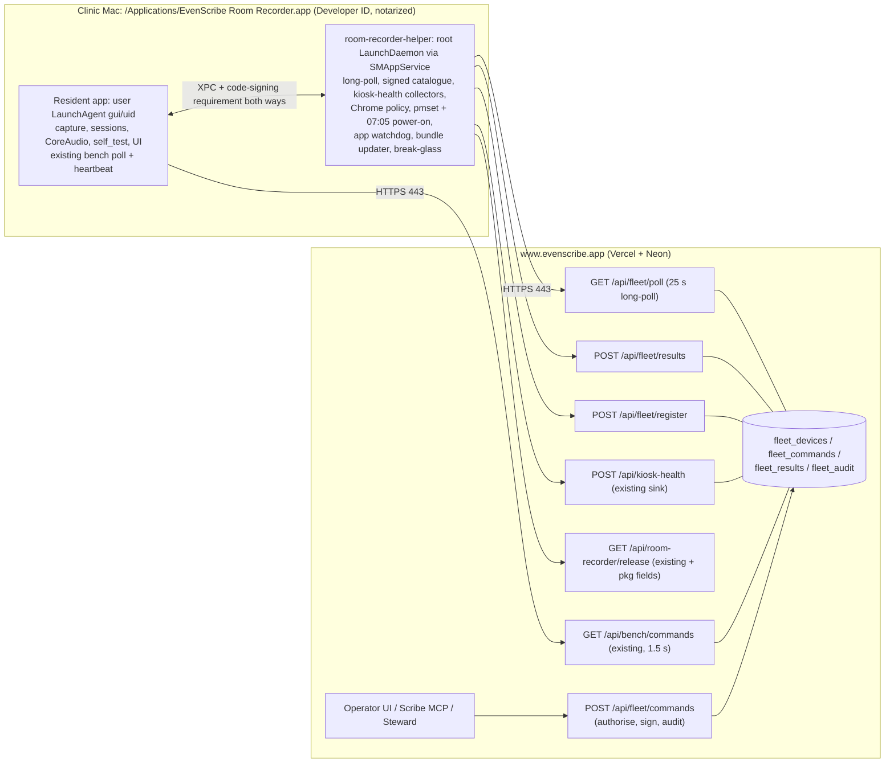

# PRD: Tailscale exit. Room Recorder privileged helper + self-owned control channel

| | |
|---|---|
| **Epic** | vinaybhardwaj-commits/Even-Scribe-Architecture#35 (children #36 to #53) |
| **Status** | Ready for build. Rulings from Vinay on 10 Oct 2026, 11:50 IST |
| **Implementation repo** | Even-Transcription-Assistant (`apps/room-recorder`, `app/api/*`, `lib/*`, `db/migrations`) |
| **Code baseline** | ETA `main @ d94e724` (recorder source 0.1.22); fleet build `fleet/rr-0.1.28 @ 7f734e1` |
| **Out of scope** | Pulse (never touched); ORB Linux rooms; MDM / Apple Business Manager (ruled out) |

## 1. Problem
Every repair, OS change and most observation of a clinic Mac goes over Tailscale SSH from the Mini, the Air or the bots:
- kickstarting the recorder, `sudo pmset`, `killall coreaudiod`
- log and audio pulls
- installing kiosk-health and presence-guard, flipping Chrome extension policy
- the SSH presence poller

When a doctor quits Tailscale, logs the room account out or uses **Shut Down**, we lose the Mac until someone walks to it. Telemetry already uses HTTPS to `www.evenscribe.app`. Control and repair do not.

## 2. What exists today (from code; builders must not re-discover this)

| Piece | Facts |
|---|---|
| **Room Recorder app** | Resident `NSApplication` with `.accessory` policy and `LSUIElement=true`: no Dock, no menu, no window (`Sources/RoomRecorderCore/ResidentApplication.swift`). |
| **Launch** | **Per-user LaunchAgent** `~/Library/LaunchAgents/com.evenscribe.room-recorder.plist`, written by `room-recorder install-launch-agent` and bootstrapped into `gui/$(id -u)`. Keys: `RunAtLoad`, `KeepAlive={SuccessfulExit:false}`, `ThrottleInterval=30`, `ProcessType=Interactive` (`Sources/RoomRecorderCLI/main.swift:277-320`). Bundle in `~/Applications`, user-owned (`lib/room-install.ts`). |
| **Lifecycle** | Relaunched after a crash, kill or non-zero exit (≥30 s apart). A clean exit 0 (`needs_enrol`, retired) stays down. Exit 64 = update handover, 75 = `restart_engine`. `launchctl bootout` or deleting the plist stops it **without admin**. The gui domain ends at logout, so the app stops (observed on OPD 3, 17 Sep). |
| **Privilege** | **None.** No sudo, no helper, no SMAppService. It only reads `pmset -g` and `launchctl print gui/<uid>`. |
| **Command channel** | `GET /api/bench/commands` every **1.5 s** with the room session JWT. The heartbeat rides on the same request (`app/api/bench/commands/route.ts`). Verbs (0.1.28): `start_day, pause_day, resume_day, end_day, set_audio_input, check_update_now, report_diag, restart_engine, self_test`. Unknown kinds are ignored. |
| **Updater** | User-level, in `RoomSelfUpdate.swift`. 6 h / session-end / on-demand check against `GET /api/room-recorder/release`. Verifies sha256 + size + a pinned leaf requirement, then a detached swap script with `.app.previous`, canary and attempt ledger. Never runs during a session. |
| **Signing** | Self-signed leaf, hardened runtime, `audio-input` entitlement only. Not Developer ID or notarized; builds happen at the console. |
| **kiosk-health** | Separate **root LaunchDaemon**, ad-hoc signed. Source is only on the Mini (`~/dev/eta-kiosk-health`, no remote). Posts events to `POST /api/kiosk-health` (shared bearer). Installed over SSH. |
| **presence-guard** | Separate **root LaunchDaemon** (bash). Re-asserts Chrome `ExtensionInstallForcelist` every 60 s, because macOS wipes the hand-written managed-prefs file at boot. Installed over SSH. |
| **Steward executor** | Server side built (`lib/steward/tickets.ts`: Ed25519 tickets, allowlist, TTL ≤900 s; `GET /api/steward/tickets`). The Mac-side executor is **never installed**, and all `ticket:*` actions are shadowed. |
| **Pulse Presence extension** | Posts **directly over HTTPS** to `www.evenscribe.app/api/presence`. Its Tailscale dependency is install, update, policy and health observation (the SSH poller). Per-machine CRXs with a baked token are served publicly from `public/ext/<machine>/`, so the token must be treated as exposed. |

## 3. Goals and non-goals
**Goals**
1. Every runbook action in §9 works with Tailscale off, through an outbound-only HTTPS channel.
2. One bundle, one install, one update path. The privileged part lives **inside** the Room Recorder bundle.
3. Survives logout, quit, killing the app and evening Shut Down (power-on at 07:05).
4. Least privilege: a closed, signed command catalogue. No remote shell. No PHI in commands or results.
5. Tailscale remains as audited, time-boxed break-glass.

**Non-goals**
- Preventing a determined admin from removing the software (impossible without MDM; detect and alert instead).
- Remote TCC grants.
- Autologin changes.
- Pulse changes.

## 4. Design



### 4.1 Process split
| Responsibility | Resident app (exists, user) | Helper (new, root, same bundle) |
|---|---|---|
| Capture, sessions, CoreAudio input, mic TCC, self_test | ✔ | ✘ (never opens audio) |
| Bench poll (1.5 s) + heartbeat | ✔ unchanged | ✘ |
| Fleet long-poll + signed catalogue | ✘ | ✔ |
| Telemetry collectors (port of kiosk-health) | ✘ | ✔ |
| Chrome policy for the extension (port of presence-guard) | ✘ | ✔ |
| Steward tickets (v1 accepted, v2 envelope native) | ✘ | ✔ |
| Relaunch app (kickstart/bootstrap `gui/<console uid>`) | ✘ | ✔ |
| Bundle update + rollback | fallback for one release | ✔ primary |

### 4.2 Packaging
- Developer ID Application + Installer, hardened runtime, notarized, stapled, built in CI.
- Signed `.pkg` installs to `/Applications`, root:wheel 0755. A root daemon must not execute user-writable code.
- `Contents/Library/LaunchDaemons/com.evenscribe.room-recorder.helper.plist`: `Label`, `BundleProgram=Contents/MacOS/room-recorder-helper`, `RunAtLoad=true`, `KeepAlive=true`, `MachServices={com.evenscribe.room-recorder.helper.xpc=true}`, `AssociatedBundleIdentifiers=[com.evenscribe.room-recorder]`.
- The app calls `SMAppService.daemon(plistName:).register()`. Approval in System Settings › Login Items happens once per room, at the same console visit as the mic re-grant.
- The user LaunchAgent stays as it is (path updated to `/Applications`).

### 4.3 XPC
- Mach service `com.evenscribe.room-recorder.helper.xpc`.
- Peer requirement on both sides: `anchor apple generic and certificate leaf[subject.OU] = "<TEAMID>" and identifier "com.evenscribe.room-recorder"` (the helper checks the app) / `... identifier "com.evenscribe.room-recorder.helper"` (the app checks the helper).
- Closed protocol:
  - `hello() → {version, pid}`
  - `appStatus() → {session_open, tape_advancing, mic_state, version}`
  - `helperStatus() → HelperStatus`
  - `runAppVerb(verb, params) → Result`, restricted to app-side catalogue verbs
  - `requestBundleUpdate() → Accepted|Refused`
  - `sessionToken() → room JWT`, used only for registration
- No generic exec.

## 5. Data contracts

### 5.1 Device registration
`POST /api/fleet/register`, with `Authorization: Bearer <room session JWT>` (obtained by the helper over XPC from the app)
```json
{
  "install_id": "uuid",
  "machine": "ehrc-consul4",
  "hw_model": "Macmini9,1",
  "serial_hash": "sha256(serial + server_salt_id)",
  "helper_version": "0.2.0",
  "key_alg": "ed25519",
  "public_key": "base64(32 bytes)"
}
```
Response `201`:
```json
{
  "device_id": "dev_…",
  "server_key_ids": ["fk1", "fk2"],
  "poll_url": "/api/fleet/poll",
  "registered_at": "ISO-8601"
}
```
- **Rules:** one active key per `install_id`. Re-registering with the same key is idempotent. A new key needs `rotate_identity` (signed by the old key) or operator re-enrol. A retired install gets `409 RETIRED`.

### 5.2 Device request auth
Every helper request carries `Authorization: Device <JWS>`:
- header `{alg: "EdDSA", kid: device_id}`
- claims `{iss: device_id, aud: "evenscribe-fleet", iat, exp ≤ iat+300, jti: uuid}`

The server verifies against `fleet_devices.public_key`, rejects a seen `jti` (10 min window), and allows ±120 s skew.

### 5.3 Command envelope v2 (server → helper)
```json
{
  "v": 2,
  "cmd_id": "cmd_01J…",
  "device_id": "dev_…",
  "machine": "ehrc-consul4",
  "verb": "coreaudiod_reset",
  "params": {},
  "issued_at": "2026-10-10T07:00:00Z",
  "expires_at": "2026-10-10T07:05:00Z",
  "nonce": "base64(16 bytes)",
  "issuer": { "kind": "operator", "id": "vinay" },
  "approval_ref": "go_…",
  "key_id": "fk1",
  "signature": "base64(ed25519(canonical(envelope minus signature)))"
}
```
- **Canonical form:** JSON with keys sorted bytewise at every depth, no insignificant whitespace, UTF-8, integers only (no floats), integer-like object keys forbidden. This is the same rule as `lib/steward/tickets.ts` v1.
- **Helper verification order** (the first failure wins and is reported as `outcome=refused, reason=<code>`):
  1. shape (`malformed`)
  2. `key_id` known and signature valid (`bad_signature`; keys compiled in, current + next)
  3. `expires_at - issued_at ≤ 900 s` and now ∈ [issued_at−120 s, expires_at] (`expired`)
  4. nonce unseen in the last 1,000 (`replay`)
  5. `device_id`/`machine` match (`machine_mismatch`)
  6. verb in the allowlist (`verb_not_allowed`)
  7. params match the closed schema (`bad_params`)
  8. local gates (`session_open`, `no_console_user`, `clinic_hours_needs_approval`, `hid_active`)
  9. device rate ceiling (`rate_limited`)
  10. kill switch (`kill_switch`)

### 5.4 Result (helper → server)
`POST /api/fleet/results` (device auth)
```json
{
  "cmd_id": "cmd_01J…",
  "device_id": "dev_…",
  "outcome": "ok",
  "reason": null,
  "started_at": "…",
  "finished_at": "…",
  "detail": { "exit": 0, "notes": "coreaudiod restarted; default input = USB Audio" },
  "upload": { "kind": "diag_bundle", "r2_key": "fleet/diag/dev_…/cmd_….zip", "bytes": 412331 }
}
```
- `outcome` is one of `ok | refused | failed | unsupported`.
- `detail` is a closed per-verb schema, ≤4 KB, with **no PHI**: no patient names, no transcript text, no audio.

### 5.5 Long-poll
`GET /api/fleet/poll?wait=25` returns `200 {server_time, kill_switch: {global: bool, reason?}, commands: [envelope…]}`.
- An empty `commands` list after ≤25 s is normal.
- The helper re-polls immediately, with backoff 1, 2, 4 … 60 s on errors.

### 5.6 Helper heartbeat
A kiosk-health envelope with `kind: "helper.heartbeat"` every 60 s to `POST /api/kiosk-health`, with device auth (the shared bearer is accepted during migration):
```json
{
  "kind": "helper.heartbeat",
  "machine": "ehrc-consul4",
  "ts": "…",
  "source": "helper",
  "data": {
    "helper_version": "0.2.0",
    "app_version": "0.2.0",
    "build_sha": "…",
    "registration": "enabled",
    "poll_last_ok_s": 3,
    "xpc_ok": true,
    "app_state": "running",
    "console_user": true,
    "session_open": false,
    "power_schedule": "MTWRFSU 07:05",
    "pmset_drift": [],
    "chrome_policy": "ok",
    "spool_bytes": 0,
    "safe_mode": false,
    "kill_switch_local": false,
    "breakglass": null
  }
}
```
- `registration` is one of `enabled | requires_approval | not_registered`.
- `app_state` is one of `running | missing | no_console_user | needs_enrol | retired`.
- `breakglass` is `null`, or `{what, until}` while open.

The bench poll gains `helper_version`, `helper_registration`, `helper_xpc_ok` (app side).

### 5.7 Release manifest additions
`GET /api/room-recorder/release` adds `pkg_url`, `pkg_sha256`, `pkg_bytes`, `cohort`, `rollout_pct`, `min_helper`. Existing fields stay.

### 5.8 Tables (additive migration)
| Table | Columns |
|---|---|
| `fleet_devices` | `device_id` pk, `install_id` unique, `machine`, `public_key`, `key_alg`, `status` (`active` / `revoked`), `registered_at`, `rotated_at`, `last_poll_at`, `helper_version` |
| `fleet_commands` | `cmd_id` pk, `device_id`, `verb`, `params` jsonb, `issued_at`, `expires_at`, `nonce`, `issuer_kind`, `issuer_id`, `approval_ref`, `key_id`, `signature`, `state` (`queued` / `delivered` / `done` / `expired`) |
| `fleet_results` | `cmd_id` pk/fk, `outcome`, `reason`, `started_at`, `finished_at`, `detail` jsonb, `upload_key` |
| `fleet_audit` | append-only. `id`, `ts`, `actor`, `action`, `cmd_id`, `machine`, `summary`. 90-day retention |

## 6. Command catalogue v1 (H = helper, A = app via XPC)
| Group | Verb | Runs | Params (closed) | Gates |
|---|---|---|---|---|
| Diagnose | `helper_status` | H | — | — |
| | `collect_diag` | H | `scope ∈ {recorder,audio,power,chrome,helper}`, `log_lines ≤ 500` | ≤5 MB; deny-list `*.pcm *.opus tape* archive/ Chrome profile`; redacted |
| | `report_diag` | A | — | exists |
| Audio | `list_audio_inputs` / `select_audio_input` | A | `device_uid`, `input_volume?∈[0,1]` | exists as `set_audio_input` |
| | `coreaudiod_reset` | H | — | no open session; clinic hours need approval_ref; ≤1 per 30 min |
| | `usb_reseat` | H | `port?` | returns `unsupported` until hardware exists |
| | `self_test` | A | `volume` | existing 0.1.27 gates |
| Lifecycle | `restart_recorder` | H/A | `force?` | open session needs force + approval_ref |
| | `reload_launchagent` | H | — | needs a console user |
| | `pieces_inventory` / `pieces_reupload` | A | `since?` | counts only / re-drive the uploader |
| Power | `wake` | H | — | — |
| | `pmset_enforce` | H | — | compiled-in baseline |
| | `schedule_poweron` | H | `time="HH:MM"` default 07:05 | — |
| Chrome | `chrome_policy_apply` | H | — | — |
| | `chrome_relaunch` / `open_pulse` / `policy_cycle` | H | `profile` | HID idle ≥600 s; ≤1 relaunch per 30 min |
| Update | `update_bundle` / `rollback_bundle` | H | `channel?` | never during an open session; ≤2 per day |
| Admin | `rotate_identity` | H | — | — |
| | `set_local_kill_switch` | H | `on` | — |
| | `retire_legacy` | H | `component ∈ {kiosk-health, presence-guard}` | — |
| | `breakglass_enable` / `breakglass_disable` | H | `what ∈ {tailscale,sshd,both}`, `ttl_min ≤ 60` | approval_ref always |

Not provided: shell, arbitrary file read/write, keychain access, account changes, network configuration, autologin.

**Device ceilings (compiled in):** ≤10 privileged verbs per hour. Safe mode after 3 helper crash loops: only diagnose + update.

## 7. Behaviours

### 7.1 Watchdog
- Every 30 s the helper checks for a console user, the app process and an XPC hello. If any fails, it re-writes the user plist if missing, then bootstraps or kickstarts `gui/<uid>/com.evenscribe.room-recorder`. Backoff 30 s → 5 min.
- It never fights `needs_enrol` or `retired`.
- The app reports `helper_state`.
- Server attention rules: `app_missing` and `helper_missing` (3 min).

### 7.2 Power
- At start and daily, the helper applies the baseline (sleep 0, disksleep 0, displaysleep 0, powernap 0, autorestart 1, womp 1) and `pmset repeat wakeorpoweron MTWRFSU 07:05:00`.
- Drift is reverted within 15 min and logged.

### 7.3 Chrome policy
- Atomic rewrite of the `ExtensionInstallForcelist` entry plus `3rdparty.extensions.<id>` config, preserving other keys. Boot-race loop for 300 s after boot, `killall cfprefsd` after a change.
- The token is never logged.

### 7.4 Update
1. Download the pkg, then check sha256, `pkgutil --check-signature` (Team ID) and `spctl -a -t install`.
2. Wait for no open session.
3. Snapshot to `/Library/Application Support/EvenScribe/rollback/<ver>.app`.
4. `installer -pkg`, re-register the helper if its plist changed, kickstart the app.
5. Require an XPC hello + bench heartbeat within 5 min, else restore and report `rolled_back`.

Cohorts: Home Office → Audiometry → 1 OPD → 50% → 100%.

### 7.5 Offline
- Spool ≤50 MB, oldest-first flush, never dropping power, audio or watchdog events.
- Commands are never executed after expiry.
- Local policies (watchdog, power, Chrome, DarkWake) keep running offline.

### 7.6 Break-glass
- Starts Tailscale and/or `system/com.openssh.sshd`, and persists `{what, until}`. It is disabled at TTL, even across a reboot.
- Bench shows a red banner. Approval is always required.

## 8. Security and compliance
- No PHI in commands, results, heartbeats or diag bundles (redaction + deny-list + tests).
- Root code is limited to the helper and runs from a root-owned path. XPC peers are pinned by Team ID.
- Per-device keys replace the shared bearers (`KIOSK_HEALTH_INGEST_TOKEN`, `PRESENCE_INGEST_TOKEN`) after the migration window.
- Issuers:
  - Operators (Vinay + named delegates). Privileged verbs in clinic hours (07:30 to 21:30 IST) need Vinay GO (`approval_ref`).
  - The Steward within its shadow flags.
  - Bots via the MCP door under the same rules.
- **Known limit:** an admin (room accounts stay admin) can boot out the helper, toggle it off in Login Items, delete the bundle or clear `pmset repeat`. This is detected (`helper_missing` within 3 min) but not prevented.

## 9. Acceptance criteria (epic level)
1. **Logout/quit:** after `launchctl bootout gui/<uid>/com.evenscribe.room-recorder` by the room user, the app polls again within 60 s. After logout then login, it polls within 60 s of login. At the login window the helper heartbeat stays fresh.
2. **Shut Down:** after an evening Shut Down, the Mac is polling by 07:10 IST (twice, on a real room).
3. **Tailscale off:** with Tailscale quit on a room for a full clinic day, every row below works and Bench shows the room `reachable` (no false R1).
4. **Parity rows**, each passing on ≥2 rooms without SSH:
   - kickstart → `restart_recorder`, first piece ≤5 min
   - upgrade an old room → pkg + `update_bundle`
   - pmset baseline → `pmset_enforce`
   - `coreaudiod_reset`
   - log/audio proof → `collect_diag` + `report_diag`
   - piece inventory → `pieces_inventory`
   - extension policy after 3 reboots → ext rows ≤2 min after login
   - Steward tickets live per action
   - Liason RCA via the MCP door
5. **Security:** every rejection code in §5.3 has a test. Cross-language signing vectors pass (TS signs, Swift verifies). An ad-hoc signed XPC client is refused. PHI scan of diag bundles is clean.
6. **Rollback:** a deliberately broken build rolls back within 10 min with recording uninterrupted on N-1. No update is ever applied during an open session.
7. **Cutover:** the standalone kiosk-health and presence-guard daemons are removed. The SSH poller is off. Bot SSH keys are removed from rooms. 14 days with no SSH session to any room.
8. **Break-glass:** opens within 60 s with approval, auto-closes at TTL (including across a reboot), and is refused without approval. Every use is audited.

## 10. Slices (GitHub issues)
| # | Slice | Depends on |
|---|---|---|
| #36 | TS-E1 Presence poller → heartbeat reachability | — |
| #37 | TS-E2 Extension token rotation + stop public per-machine CRXs | — |
| #38 | TS-H1 Developer ID + notarization + pkg, move to /Applications | — |
| #39 | TS-H2 SMAppService helper skeleton + XPC | H1 |
| #40 | TS-H3 Long-poll + device identity | H2 |
| #41 | TS-H4 Envelope v2 + verifier + Diagnose verbs | H3 |
| #42 | TS-H5 Audio + lifecycle verbs | H4 |
| #43 | TS-H6 Power: pmset + 07:05 power-on + wake | H4 |
| #44 | TS-H7 Helper-managed Chrome policy | H2, E2 |
| #45 | TS-H8 Bundle self-update + rollback | H1, H2 |
| #46 | TS-H9 App relaunch watchdog + missing alerts | H2 |
| #47 | TS-H10 Absorb kiosk-health | H2, H3 |
| #48 | TS-H11 Retire standalone presence-guard | H7 |
| #49 | TS-H12 Steward executor go-live | H4, H7, H9 |
| #50 | TS-H13 Bench + MCP visibility, command audit | H3, H4 |
| #51 | TS-H14 Parity checklist | H4 to H13 |
| #52 | TS-H15 Cutover | H14 |
| #53 | TS-H16 Tailscale break-glass | H4 |

## 11. Open questions
1. Approvers besides Vinay for clinic-hours privileged verbs and break-glass?
2. Consent screenshot verb: leave it out (current plan), since Pulse can show patient names?
3. Buy controllable USB hubs for the C270 rooms so `usb_reseat` becomes real?
4. Apple Developer Team ID, and where the signing key lives for CI.
5. Confirm on macOS 15/26 that SMAppService daemon approval and pre-login start behave as designed (H2 spike).
