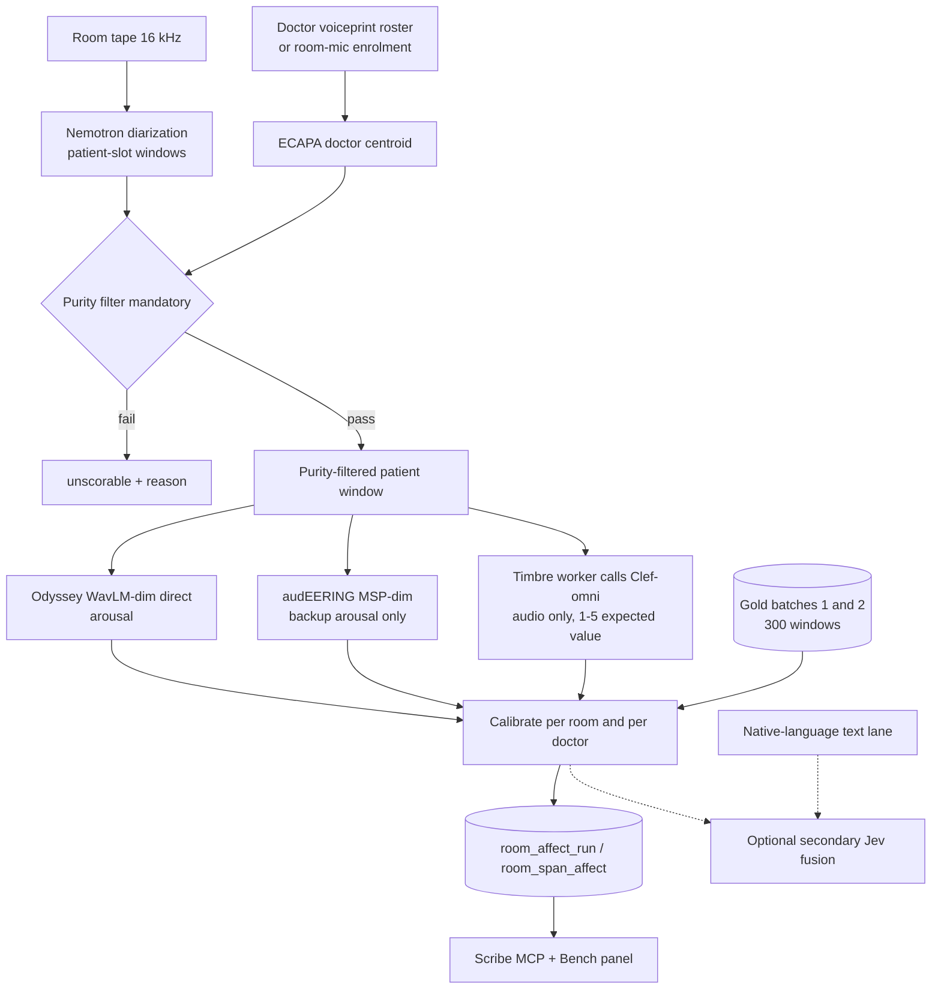

# PRD: Timbre (patient voice affect v1)

> **STATUS: PLANNING. Builders start on Vinay's GO.** Nothing here is built, deployed or migrated until Vinay says go.
>
> **Revised 11 Oct 2026 (IST)** to match Vinay's production-stack decision on [#58](https://github.com/vinaybhardwaj-commits/Even-Scribe-Architecture/issues/58#issuecomment-6107526116). That comment wins over the 10 Oct plan below wherever they differ. The batch-1 baseline is [this comment](https://github.com/vinaybhardwaj-commits/Even-Scribe-Architecture/issues/58#issuecomment-6105003504).

| | |
|---|---|
| Epic | [#58 Timbre: voice affect v1](https://github.com/vinaybhardwaj-commits/Even-Scribe-Architecture/issues/58) |
| Tickets | #70–#82 (T-1 … T-13), plus [#84](https://github.com/vinaybhardwaj-commits/Even-Scribe-Architecture/issues/84) (T-14, Clef-omni valence) |
| Owner | EvenScribe Designer (plan, gold kit); ETA builders on GO |
| Decision-maker | Vinay Bhardwaj |
| Date | 10 Oct 2026; revised 11 Oct 2026 (IST) |
| Decision record | #58 comments: baseline 11 Oct 03:25 UTC; decision 11 Oct 2026 14:49 IST |
| Research | `/home/box/shared/voice-affect/VOICE-AFFECT-MODEL-RESEARCH-2026-10-10.md` (box) |
| CAA brief | `/home/box/shared/voice-affect/CAA-BRIEF-2026-10-10.md` (box) |
| Builder checklist | `/home/box/shared/timbre/READY-CHECKLIST.md` (box) |
| Lab harness | ETA draft PRs #29–#33 (Even-Transcription-Assistant). Not this repo. |

## 1. Problem
Tonality Rubric V0 scores patient voice on room tape (C270/TONOR, 16 kHz, far-field, en/kn/hi code-mix) with two **categorical** SER heads: `Aniemore/wavlm-emotion-v1-crosslingual` (int8) and `emotion2vec/emotion2vec_plus_large`. On our tape:
- **Coverage:** only 45/96 pitch clips have a scorable patient voice, and 48/96 a validated patient speaker.
- **WavLM Aniemore** reads *neutral* in 101/116 patient windows. It is a mostly-Russian 7-class head (spontaneous macro-F1 0.36 per its model card). On batch-1 gold its arousal Spearman is 0.24 and its valence Spearman is −0.04.
- **emotion2vec+** is overconfident (median top score 0.944) and never puts angry or fearful on top. On batch-1 gold its arousal Spearman is −0.12.
- Voice tone does not predict accept/defer (no signal across 251 consults; the earlier pitch slice was 6/14 vs 6/18).
- No clinician-affect gold existed on 10 Oct. Vinay has since labelled batches 1 and 2. Those 300 windows are the gold set. There is no further human labelling round.

## 2. Decision (Vinay, 11 Oct 2026 14:49 IST)
This section is the production stack. It replaces the 10 Oct model menu, doctor-relative features, voice-only flags, the accept/defer goal, and "text decides" fusion on the critical path.

**Arousal.** Odyssey WavLM-dim (`3loi/SER-Odyssey-Baseline-WavLM-Multi-Attributes`), **direct** scores. Backup: audEERING MSP-dim (`audeering/wav2vec2-large-robust-12-ft-emotion-msp-dim`). On batch 2, held out, Odyssey arousal Spearman is **0.60** against the rater (rater self-agreement 0.53). High/low arousal extremes separate at **AUC 0.87**.

**Valence.** Cloudflare **Clef-omni** (`@cf/cloudflare/clef-omni` on Workers AI), **audio only**, on purity-filtered patient windows. The question is a **1–5** score; the stored score is the **expected value**. Pooled Spearman **0.50** (n=260, CI 0.41–0.59); batch 2 **0.58**. On the same windows Odyssey valence is 0.19 and voice + Jev-text fusion is about 0.35. Adding transcript text to Clef did not help (0.39 vs 0.43 audio-only). Answers are deterministic on repeats. Clef is not the arousal model (arousal CCC ~0.03).

**Gold.** Batches 1 and 2 (300 windows) are the gold set. No further human labelling round before build.

**Dropped**
- WavLM Aniemore (retired).
- Doctor-voice relative features (the gain did not replicate on batch 2).
- Voice-only flags (engaged / anxious / resistant / words≠tone).
- Predicting accept/defer from voice tone.

**Carried into the build**
- Patient-purity filtering is mandatory. Clef hears everyone in the window. Filter = ECAPA frame purity + Nemotron patient-slot windows.
- Calibrate per room and per doctor. Clef's absolute scale is poor; Odyssey's batch-1 arousal CCC was 0.12 despite a Spearman of 0.51.
- Doctor voiceprint coverage is a dependency of Nemotron patient mapping: 17% of objects were ok; 602/1,200 had no voiceprint ≥ 0.65. Roster or room-mic enrolment is the lever.
- Patient audio to Cloudflare Workers AI is approved by Vinay for Timbre.
- Text + voice fusion via Jev is **optional / secondary**. A native-language text lane exists, but Clef already understands speech, and text did not improve Clef.

**Planning mode is unchanged.** Builders do not start until Vinay says go.

## 3. Goals / non-goals
**Goals**
1. Attribute the patient and **reject impure windows** before any score (ECAPA frame purity + Nemotron patient-slot windows).
2. Ship **arousal** from Odyssey WavLM-dim (direct), with audEERING as backup, calibrated per room and per doctor onto the 1–5 gold scale.
3. Ship **valence** from Clef-omni expected value (audio only, purity-filtered), with the same per-room / per-doctor calibration. Use it as a ranking, not as a raw absolute scale.
4. Widen the ETA schema so those two models can write results, and retire WavLM Aniemore from the rubric.
5. Treat doctor-voiceprint coverage (roster or room-mic enrolment) as a dependency of patient mapping, not as a follow-up.

**Non-goals**
- Another human labelling round. Batches 1+2 are the gold set.
- Doctor-relative (doctor-ref) voice features.
- Voice-only flag heads.
- Predicting accept/defer, or any other visit outcome, from voice tone.
- Ranking doctors on voice affect. Empathy scores from F0 synchrony.
- Using Clef for arousal, or letting any other audio-LLM write scores. Clef's 1–5 valence question is the valence path; other audio-LLMs stay optional explainers.
- Requiring text+voice fusion for v1. Jev fusion may be added later; it is not on the critical path.
- Building anything before Vinay's GO.

## 4. Rulings
### 4.1 Still in force (Vinay, 10 Oct 2026)
- Vinay is the single primary rater. The optional CAA/LLM-proxy second check does not open another labelling round.
- HF GPU and other cloud infra already cleared for consult audio stay cleared.
- Commercial model licences, where a chosen model needs one, are procured by Vinay (T-12, non-blocking).
- Planning mode: builders start only on GO.

### 4.2 Superseded by §2 (11 Oct 2026)
- "Best-scoring models and openSMILE in production" as an open menu. Production scores are Odyssey arousal and Clef valence only. openSMILE is not on the scoring path.
- audEERING as primary, and Vox-Profile Whisper-dim as co-primary. audEERING is the arousal backup. Vox-Profile is not selected.
- "Text decides; voice is evidence" as the v1 fusion design. Fusion is optional/secondary.
- Doctor-relative features, voice-only flags, and the accept/defer evaluation goal.
- A kn/hi top-up labelling batch.

### 4.3 Added 11 Oct 2026
- Patient audio may be sent to Cloudflare Workers AI for Timbre (Clef-omni). Secret name: `CF_WORKERS_AI_TOKEN`.

## 5. Architecture and data flow
Purity runs before either model. Arousal and valence are separate calls. Calibration is the last step before a score is shown.



**Purity (mandatory).** Clef scores every voice in the clip, so an impure window is a wrong patient. Two gates, both required:
- Nemotron patient-slot windows (the diarizer's patient slots; ETA harness PR #32).
- ECAPA frame purity of those frames against the doctor centroid and other speakers.

Working keep rule from the batch-1 baseline (batch 2 was built to it): frame purity ≥ 0.6, ≥ 3 s of pure patient speech, mean patient cosine ≥ 0.30. Frame-level ECAPA purity separated the rater's not-patient windows at AUROC ≈ 0.69 (95% CI 0.53–0.82). The diarizer's own segment-purity score did not (0.39), so segment purity alone is not the filter. A window that fails is `unscorable` with a reason. It is never scored and never called "neutral".

**Voiceprints.** Nemotron's patient mapping needs the doctor's voiceprint. Coverage so far: 17% of objects ok; 602/1,200 had no voiceprint ≥ 0.65. Until roster or room-mic enrolment fills that gap, those objects stay unscorable. This is a data dependency of T-2, not a model choice.

**Arousal call.** Lab GPU (T4/L4 or the cleared HF GPU). Odyssey WavLM-dim direct dimensional output. Do not train a new head for v1. audEERING MSP-dim runs only as the backup when Odyssey cannot. Dominance is not a v1 output. Valence from either local model is logged at most as a diagnostic; it is not the product valence (Odyssey valence was 0.07 on batch 1 and 0.19 on the Clef comparison windows).

**Valence call (T-14).** The Timbre worker sends the purity-filtered patient-window audio to Workers AI model `@cf/cloudflare/clef-omni`. No transcript is attached.
- Auth: secret `CF_WORKERS_AI_TOKEN`. The token is never written to logs, rows or traces.
- Question: one 1–5 valence score. Persist the expected value of the answer distribution, plus the raw distribution in `values` if Workers AI returns it.
- Cost: about **US$0.15 per million input tokens**, about **1k input tokens per 10 s window**. The 716-call test was about US$0.11.
- Latency: about **0.3 s** (measured median 0.30 s).
- Patient audio on Workers AI is approved for Timbre. This approval is not a blanket approval for other models or other products.

**Calibration.** Fit on batches 1+2 only, separately per room and per doctor, for Odyssey arousal and for Clef valence. Batch-1 arousal CCC of 0.12 (Odyssey) and Clef CCC ~0.03 are why raw scores are not displayed. The calibration version records the cell (room, doctor, or pooled fallback). Use a pooled fallback only when that room or doctor has too little gold to fit, and mark the score as coarsely calibrated. Do not copy one doctor's map onto another without saying so.

**Optional fusion.** A native-language text lane can still feed TypeSafe Jev. Stacking that text with voice is allowed as a secondary experiment (T-7). It is not required to ship valence: Clef audio-only beat voice+Jev-text fusion (~0.35) and beat Clef-plus-transcript (0.39 vs 0.43).

## 6. Data contracts
No identities in these tables. Roles stay on `room_turn_speaker`, as in migration 0089.

### 6.1 Patient span (T-1 / T-2)
```json
{"window_id":"str","speaker_idx":1,"start_ms":142860,"end_ms":155570,
 "p_speaker":0.93,"p_overlap":0.04,"purity":0.82,"patient_cosine":0.41,
 "pure_patient_s":8.4,"voiceprint_ok":true,"snr_db":18.2,"voiced_s":9.8,
 "role":"patient","role_conf":0.88,"role_method":"ecapa+nemotron",
 "reason":null}
```
`reason` ∈ {`no_patient`, `low_purity`, `short_pure_speech`, `low_patient_cosine`, `no_voiceprint`, `overlap`, `low_snr`, `too_short`, `attender_speaks_for_patient`}. When `reason` is set, the span is not sent to Odyssey or Clef.

### 6.2 Production scores (parquet / `values` jsonb)
Required: `window_id, speaker_idx, start_ms, end_ms, purity, pure_patient_s, patient_cosine, A_ody, V_clef_ev, A_calibrated, V_calibrated, calibration_version, room, doctor_uid8, model_versions{}`.

`model_versions` names Odyssey (and audEERING if the backup ran) plus `@cf/cloudflare/clef-omni`. `A_audeering` is present only on backup rows. `V_clef_ev` is the uncalibrated expected value; `V_calibrated` is what readers display.

Not in the v1 contract: `*_rel_doctor`, flag probabilities, dominance, emotion2vec or Whisper embedding refs, a fused score. Lab harnesses may still emit them. Production writes do not require them.

### 6.3 Gold labels (T-3) — closed
Batches 1 and 2 are the gold set (300 windows). No third round.

| Batch | What Vinay labelled | Notes |
|---|---|---|
| 1 | 198 items: 180 windows, 45 consults, 13 doctors, 8 rooms, plus 18 hidden repeats | 154 usable after 13 not-patient and 13 unusable. Kit handed over 10 Oct. |
| 2 | 120 windows plus 15 repeats, 81 consults not in batch 1 | Built to the purity rule. Weighted to extremes: 30/30 high/low arousal, 25/25 high/low valence, 10 middle. Kit v1.1. |

Rater consistency on batch 1 (14 repeat pairs): arousal Spearman 0.52 / CCC 0.51; valence Spearman 0.73 / CCC 0.67; flag agreement 86–100%. That arousal ceiling is why batch-2 Odyssey Spearman 0.60 is enough to ship the rank signal, and why CCC must be fixed by calibration rather than by a new label round.

Batch-1 labels are narrow. Arousal {2:1, 3:57, 4:96}. Valence {1:1, 2:51, 3:90, 4:11, 5:1}. Flags: engaged 137, anxious 110, resistant 6, words≠tone 2. Flag base rates this skewed, plus macro-F1 0.41–0.43 for every model, are why voice-only flags are dropped.

CSV columns from the kit stay as collected (`arousal`, `valence`, flags, `not_patient`, `unusable`, …). Flags remain in the file for the record. They are not training targets.

### 6.4 Schema widening (T-9)
Same tables as the 10 Oct draft, with two contract changes: a dimensional run carries **either** arousal or valence, and nothing in the schema stores doctor-relative features or flag heads.

```sql
create table room_affect_run (
  id bigserial primary key, window_id text not null, diarize_run_id bigint,
  model_id text not null, model_version text not null,
  kind text not null check (kind in ('categorical','dimensional','features','embedding_ref','fused')),
  calibration_version text, state text not null, started_at timestamptz, finished_at timestamptz,
  unique (window_id, model_id, model_version, kind));
create table room_span_affect (
  id bigserial primary key, run_id bigint references room_affect_run(id),
  window_id text not null, speaker_idx int not null, start_ms int not null, end_ms int not null,
  source_refs jsonb, clip_r2_key text,
  values jsonb not null default '{}', arousal real, valence real, dominance real,
  confidence real, top_label text, coverage_reason text);
-- Odyssey run: arousal non-null, valence null, model_id = Odyssey. dominance stays null in v1.
-- audEERING backup run: same shape, written only when Odyssey did not run.
-- Clef run: valence non-null (calibrated), arousal null, model_id = '@cf/cloudflare/clef-omni'.
-- values holds purity, patient_cosine, pure_patient_s, raw expected value, latency_ms.
-- calibration_version identifies the room, doctor, or pooled-fallback map.
-- kind = 'fused' is optional and is not required to ship.
-- unscorable rows need coverage_reason and null arousal/valence.
-- 0089 tables (room_emotion_window / room_span_emotion) stay read-only history.
```

### 6.5 MCP read surface (T-10)
`scribe_voice_affect(window_id | encounter_id)` returns, per patient window: calibrated `arousal`, calibrated `valence`, `calibration_version`, `confidence`, `coverage_reason`, and the purity summary (`purity`, `pure_patient_s`). It returns `unscorable` with a reason and never reports "neutral" for missing or impure voice. It does not return accept/defer, flag probabilities, or a doctor ranking.

`text_voice_disagreement` is omitted unless the optional Jev fusion lane is on.

## 7. Evidence
Aggregates only. These numbers are the reason for §2. Batch-1 correlations use the 154 usable windows unless a row says otherwise. "Direct" means the model's own arousal/valence output. "Ridge" means a ridge fit in room-day cross-validation, which is not the production path.

### 7.1 Batch 1 — model vs rater

| Model | Arousal ρ | Arousal CCC | Valence ρ | Valence CCC | Source |
|---|---:|---:|---:|---:|---|
| Odyssey WavLM-dim | **0.51** | 0.12 | 0.07 | 0.12 | direct |
| audEERING MSP-dim | **0.48** | 0.15 | 0.02 | 0.05 | direct |
| Vox-Profile Whisper-dim | 0.42 | 0.19 | 0.20 | 0.17 | direct |
| eGeMAPS v02 | 0.36 | 0.28 | 0.04 | 0.04 | ridge (room-day CV) |
| ComParE-2016 | 0.35 | 0.25 | 0.07 | 0.04 | ridge |
| WavLM Aniemore (old) | 0.24 | 0.22 | −0.04 | 0.03 | ridge |
| Whisper-large-v3 encoder | 0.11 | 0.13 | 0.27 | 0.24 | ridge |
| emotion2vec+ large | −0.12 | −0.12 | 0.26 | 0.21 | ridge |

- Flag macro-F1 is 0.41–0.43 for every model (chance). No voice-only flag head.
- High-confidence subset (n=70): audEERING arousal 0.49 / valence 0.13; Odyssey arousal 0.35 / valence 0.22. audEERING stays the arousal backup because of this slice, not because it wins the full set.
- Rater repeat agreement (14 pairs): arousal ρ 0.52 / CCC 0.51; valence ρ 0.73 / CCC 0.67.

### 7.2 Batch 2 and the Clef comparison

| Signal | Result |
|---|---|
| Odyssey arousal, batch 2 held out | Spearman **0.60** (rater self-agreement 0.53) |
| Odyssey high vs low arousal | AUC **0.87** |
| Clef-omni valence, pooled | Spearman **0.50** (n=260, CI 0.41–0.59) |
| Clef-omni valence, batch 2 | Spearman **0.58** |
| Odyssey valence, same windows | 0.19 |
| Voice + Jev-text fusion, same windows | ~0.35 |
| Clef + transcript vs Clef audio-only | 0.39 vs **0.43** |
| Clef arousal / absolute scale | CCC ~0.03 — do not use |
| Accept/defer from voice tone | no signal across 251 consults |
| Clef repeats | deterministic |
| Clef latency | median 0.30 s |
| Clef cost | ~US$0.15 / M input tokens; ~1k tokens / 10 s; ~US$0.11 for 716 calls |

### 7.3 Attribution
- ECAPA frame purity vs the rater's not-patient mark: AUROC ≈ 0.69 (95% CI 0.53–0.82). Diarizer segment purity: 0.39.
- Batch-1 notes often mention the doctor, a translator or an attender inside a "patient" window, and arousal agreement was higher in low-purity windows. Treat batch-1 agreement as an upper bound that may include room energy. Production metrics are on the purity-filtered set.
- Doctor voiceprints: 17% of objects ok; 602/1,200 had no voiceprint ≥ 0.65.

## 8. Evaluation bar (T-8)
Pre-register against the gold set (batches 1+2), not against visit outcomes.

- **Arousal:** Spearman vs Vinay, pooled and per room. Batch-2 held-out 0.60 (rater self-agreement 0.53) is the reference the production Odyssey path already met. Report CCC after per-room/doctor calibration. Report high/low AUC (reference 0.87).
- **Valence:** Spearman vs Vinay for calibrated Clef expected value. References: pooled 0.50 (n=260, CI 0.41–0.59) and batch 2 0.58. Report n and CCC per room and per doctor. Do not report Clef arousal as a result.
- **Purity:** every metric is paired with the keep rate and the reason mix. Confirm the ECAPA gate still separates not-patient above the diarizer's 0.39 segment score.
- **Retired baseline:** WavLM Aniemore stays retired (batch-1 arousal ρ 0.24). No need to re-litigate it unless a regression puts it back.
- **Not ship criteria:** voice-only flags, accept/defer, unresolved doubts, or a beyond-text lift. Those were the 10 Oct bar. Accept/defer had no signal on 251 consults, and fusion lost to Clef audio-only.
- **Coverage:** validated patient speaker ≥ 80% on a hand-checked 50-clip set remains the target. The voiceprint hole (17% ok) can block it. Missing voiceprints are reported as unscorable, not filled by guessing the patient.
- **Slices:** C270/TONOR, en/kn/hi, SNR, room, doctor, overlap. Sex only if the gold file already has it without new labelling.

Cut-over (T-10) still waits for Vinay's GO plus a written calibration report (n per cell, fallback rate, Spearman before and after). It does not wait for an accept/defer result.

## 9. Compute and cost
| Job | Where | Note |
|---|---|---|
| Nemotron, ECAPA purity, Odyssey, audEERING backup | Lab T4/L4, or cleared HF GPU | Nightly batch. Mac mini is retired as the SER host. |
| Clef-omni valence | Cloudflare Workers AI, called by the Timbre worker | `@cf/cloudflare/clef-omni`. Secret `CF_WORKERS_AI_TOKEN`. ~US$0.15/M input tokens, ~1k tokens/10 s, ~0.3 s. |
| Optional Jev fusion | Existing Jev text lane | Off the critical path. |
| Stretch fine-tune (T-13) | HF GPU | Not required for v1. |

Gold labelling is finished (batches 1+2). Do not schedule another round. v1 score-model cost is dominated by Workers AI token volume and the lab GPU batch, not by a training run.

## 10. Ticket map
Disposition after the 11 Oct decision. Comments on #70–#82 record the same map. Status of every ticket remains PLANNING until Vinay says go.

| Ticket | Issue | Disposition |
|---|---|---|
| T-1 Patient-frame selector | [#70](https://github.com/vinaybhardwaj-commits/Even-Scribe-Architecture/issues/70) | **Modified.** Purity is mandatory: ECAPA frame purity and Nemotron patient-slot windows, with the §5 keep rule. |
| T-2 Patient attribution v2 | [#71](https://github.com/vinaybhardwaj-commits/Even-Scribe-Architecture/issues/71) | **Modified.** Doctor voiceprint coverage / roster is a dependency (17% of objects ok; 602/1,200 below 0.65). |
| T-3 Gold labelling | [#72](https://github.com/vinaybhardwaj-commits/Even-Scribe-Architecture/issues/72) | **Done for v1.** Batches 1+2 (300 windows) are the gold set. No further human labelling round. |
| T-4 openSMILE prosody | [#73](https://github.com/vinaybhardwaj-commits/Even-Scribe-Architecture/issues/73) | **Doctor-ref superseded.** Relative-to-doctor columns are dropped. Prosody is off the scoring path (arousal ρ 0.36 / 0.35, valence ~0). |
| T-5 Dimensional SER | [#74](https://github.com/vinaybhardwaj-commits/Even-Scribe-Architecture/issues/74) | **Modified.** Odyssey direct is production arousal. audEERING is backup. Vox-Profile is not selected. No valence from these models. Arousal calibration stays here. |
| T-6 Embeddings | [#75](https://github.com/vinaybhardwaj-commits/Even-Scribe-Architecture/issues/75) | **Superseded for v1.** The trained embedding head is not on the production path. |
| T-7 Heads + Jev fusion | [#76](https://github.com/vinaybhardwaj-commits/Even-Scribe-Architecture/issues/76) | **Modified.** Flag heads dropped. Fusion is optional/secondary. Clef replaces this ticket as the valence path. |
| T-8 Evaluation | [#77](https://github.com/vinaybhardwaj-commits/Even-Scribe-Architecture/issues/77) | **Modified.** Accept/defer goal dropped. Bar is §8 (gold arousal/valence, purity, calibration). |
| T-9 Affect schema | [#78](https://github.com/vinaybhardwaj-commits/Even-Scribe-Architecture/issues/78) | **Modified.** Still required. One run per model; arousal and valence are different rows. No doctor-ref or flag columns. `fused` optional. |
| T-10 Cut-over | [#79](https://github.com/vinaybhardwaj-commits/Even-Scribe-Architecture/issues/79) | **Modified.** WavLM Aniemore retirement stands. Surfaces show calibrated Odyssey arousal and Clef valence. |
| T-11 Audio-LLM explainer | [#80](https://github.com/vinaybhardwaj-commits/Even-Scribe-Architecture/issues/80) | **Modified.** Stays optional. Disagreement clips are not on the critical path. Clef is not this explainer. |
| T-12 Licences | [#81](https://github.com/vinaybhardwaj-commits/Even-Scribe-Architecture/issues/81) | **Modified.** audEERING is the backup. Clef is Workers AI billing under `CF_WORKERS_AI_TOKEN`, already approved for Timbre patient audio. |
| T-13 Fine-tune | [#82](https://github.com/vinaybhardwaj-commits/Even-Scribe-Architecture/issues/82) | **Modified.** Stretch only. v1 does not wait on it. Compute plan includes the Workers AI unit cost. |
| T-14 Clef-omni valence | [#84](https://github.com/vinaybhardwaj-commits/Even-Scribe-Architecture/issues/84) | **New.** Extractor, 1–5 expected value, per-room/doctor calibration. Linked to #58. |

## 11. Rollout
1. Voiceprint roster or room-mic enrolment, in parallel with T-1/T-2. Objects without a voiceprint ≥ 0.65 stay unscorable.
2. On GO: T-1, T-2, T-9 (staging), T-5 (Odyssey arousal + audEERING backup + arousal calibration), T-14 (Clef valence + valence calibration).
3. T-8 report against §8.
4. T-10 cut-over only after that report and Vinay's GO: retire WavLM Aniemore, publish `consult-tonality-v1` as calibrated arousal + valence.
5. T-4, T-6, T-7, T-11 and T-13 stay off the critical path.

Rollback: keep v0 tables readable until v1 has run for 2 weeks. Do not put WavLM Aniemore back into the rubric.

## 12. Risks
- **Clef hears the whole window.** A missed purity gate attributes the doctor's or attender's voice to the patient. Fail closed.
- **Voiceprint holes.** 602/1,200 objects had no voiceprint ≥ 0.65. Coverage will miss the 80% target until the roster grows. Report the hole; do not relax the gate to hide it.
- **Batch-1 leakage.** Arousal agreement was higher on low-purity windows. Do not quote batch-1 Spearman as a production KPI without the purity filter.
- **Narrow gold.** Most batch-1 arousal labels are 3 or 4, and valence is piled on 2–3. Calibration can look stable while the tails are thin. Publish n per cell.
- **Single rater.** Intra-rater arousal CCC is 0.51. The model cannot be asked to beat a ceiling the rater does not clear. No second labelling round is planned.
- **Scale.** Raw Clef and raw Odyssey are not 1–5 displays. Ship the calibrated value and its calibration version.
- **Room/mic.** Calibrate per room and per doctor. Do not revive doctor-relative features; that gain did not replicate on batch 2.
- **Workers AI.** The token is a secret. Patient audio for Timbre is approved; do not reuse the client for a different model without a new ruling.
- **Optional fusion drift.** A later Jev stack must beat Clef audio-only (0.50 pooled / 0.58 batch 2) before it replaces valence. Text-on-Clef already failed that test.

## 13. Open items
- **R2 `lab/nemotron-probs/` is still T-1's first check.** The 11 Oct decision requires Nemotron patient-slot windows. It does not, by itself, prove the production key layout. Confirm it or ship `return_probs`.
- **Doctor voiceprint roster** (or room-mic enrolment) is unresolved product work. 17% coverage is not enough for the 80% patient-speaker target.
- **Per-cell gold size** for calibration is not set here. T-5 and T-14 choose the minimum n, document the pooled fallback, and abstain rather than invent a map.
- The kn/hi top-up batch from the 10 Oct draft is **closed**. There is no further labelling round.
